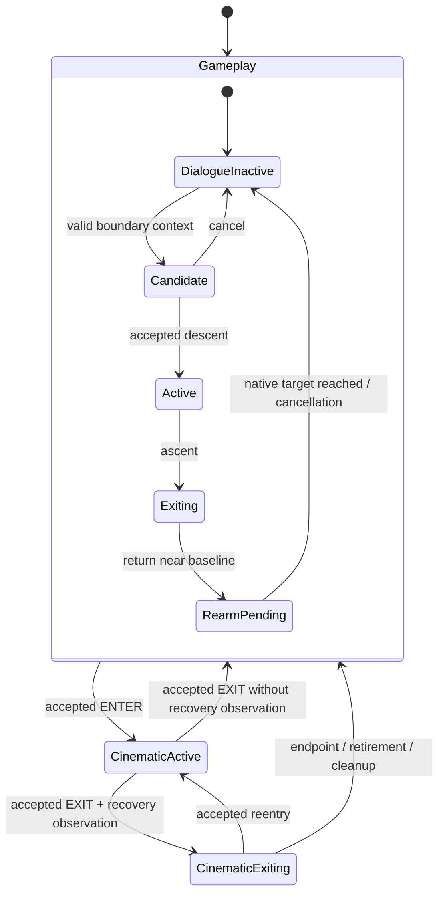

# Поточна архітектура Camera FOV

Дата аудиту: **12 листопада 2026**. Предмет: фактичний production-код, committed версія та поточні незакомічені зміни. Це опис реалізації, її походження та меж гарантій; документ не задає нову архітектуру і не пропонує виправлень.

## 1. Межа ревізії та спосіб перевірки

Committed base: `54212ee8bb94f451d9ff5c45a2b97bf23b757c2e`, `release: prepare v3.2.2`. Під **HEAD** нижче мається на увазі саме цей commit. **Index** — staged snapshot; **working tree** включає також unstaged та untracked файли. **Effective current source** — код, який звичайний production build бере з цього working tree. Це не твердження про побайтову тотожність уже встановленого ASI цьому дереву.

До аналізу виконано `git status --short --untracked-files=all`, `git diff`, `git diff --cached`, `git diff HEAD`, інвентаризацію untracked `src` та історію camera-related commits. Повні результати до створення цього документа збережено у workspace: [current-architecture-audit-20261112](../../02-Research/evidence/current-architecture-audit-20261112/git-status.txt), з файлами `unstaged.diff`, `staged.diff`, `effective-vs-head.diff` та `source-hashes.json`. Ці посилання на evidence поза Git repository доступні у локальному workspace.

Git index, branch та commits не змінювалися. Production-код, build inputs, INI й ASI не змінювалися. Нових тестів, збірок, запусків гри, debugger або native analysis tools у цьому аудиті не було. Історичні PASS і runtime captures нижче мають власні межі; вони не оголошуються перевіркою всієї поточної сукупності змін.

Першоджерело для поточної поведінки — source. Design records використано для історичного призначення; наявність тексту у звіті не замінює перевірку виконуваного шляху. Попередній проєкт `NativeSample + ConfirmedGameplayReference + ContinuityOutput` **не реалізований як нова production модель** і тут не підміняє чинні структури.

## 2. Component ownership та точки втручання

### 2.1. Власники стану

| Компонент | Власність і призначення | Source |
| --- | --- | --- |
| Private `plugin::detail::RuntimeState` | Selected/active settings, capabilities, hook handles, coordinator, baseline, cinematic association/recovery, Dialogue phases, snapshots, diagnostics | [runtime.cpp:178](src/plugin/runtime.cpp#L178), instance на [403](src/plugin/runtime.cpp#L403) |
| `CameraCorrectionGate` | Серіалізує модові camera callbacks та camera-setting commits; transaction перевіряє володіння gate | [camera_correction_gate.hpp:13](src/plugin/camera_correction_gate.hpp#L13) |
| `ProcessCameraWriter` | Основний shared writer transaction: observation/association, retirement, exclusion, recovery, cinematic policy, Gameplay policy | [camera_writer_transaction.hpp:1291](src/plugin/camera_writer_transaction.hpp#L1291) |
| `ProcessAcceptedCinematicEnter/Exit` | Прийнята generation, settings snapshot, target, continuation і передавання recovery authority | [cinematic_lifecycle_transaction.hpp:161](src/plugin/cinematic_lifecycle_transaction.hpp#L161), [378](src/plugin/cinematic_lifecycle_transaction.hpp#L378) |
| `CinematicWriterAssociation` | Source association поточної generation, latest writer, initial establishment, per-invocation admitted output | [cinematic_fov.cpp:24](src/cinematics/cinematic_fov.cpp#L24) |
| `CinematicRecoveryOwner` | Source/generation authority для post-EXIT recovery; destination — історична metadata | [cinematic_fov.cpp:247](src/cinematics/cinematic_fov.cpp#L247) |
| `ProcessDialogueBoundary` | Незалежний Dialogue classifier і correction lifecycle | [dialogue_boundary_transaction.hpp:119](src/plugin/dialogue_boundary_transaction.hpp#L119) |
| `camera::HorPlus`, `cinematics::*`, `dialogue::*` | Domain math/policies; самі не володіють global Runtime lifecycle | [horplus.cpp:7](src/camera/horplus.cpp#L7), [cinematic_fov.cpp:354](src/cinematics/cinematic_fov.cpp#L354), [dialogue_fov.cpp:8](src/dialogue/dialogue_fov.cpp#L8) |
| Runtime settings API | Перевіряє mutation, змінює effective selection, віддає readback; persistence відокремлена від фізичної camera mutation | [runtime_settings.hpp](src/plugin/runtime_settings.hpp), [runtime_settings.cpp:26](src/plugin/runtime_settings.cpp#L26) |
| Camera State publication | Спостережувана проєкція фактів із provenance/freshness; не authority cinematic baseline | [camera_state_publication.hpp:193](src/camera/camera_state_publication.hpp#L193) |

RuntimeState має process lifetime (`*new RuntimeState{}`). `g_*` references у runtime.cpp переважно є aliases на його поля, а не окремими lifecycle owners. Mutex/gate захищає взаємодію мода; він не заморожує engine-owned пам'ять між SafeRead.

### 2.2. Hooks і capability

| Hook | Вхід / дія мода | Native продовження |
| --- | --- | --- |
| Shared camera writer, `ReplayManualTransition` | RSI=source, RBX=destination, XMM0=incoming FOV. За `mutateFov` замінює saved XMM0 | Валідована інструкція `MOVSS [RBX+0x30],XMM0` виконує store |
| Cinematic ENTER | Читає incoming authored XMM0, приймає generation/settings, обчислює target і замінює XMM0, коли correction дозволена | Native consumer отримує обраний scalar |
| Cinematic EXIT | Читає native EXIT target, завершує прийняту generation, захоплює recovery owner; це не повторний HorPlus target | Native EXIT виконується зі своїм target |
| Cinematic aspect store | Target object у RAX; замінює 10-byte native aspect store, просуває RIP, записує aspect із policy | Подальші native інструкції; flags цей primitive не змінює |
| Dialogue boundary | XMM6=incoming blend sample, RSI=blend context, `[RSI+0x2C]`=target; за policy змінює тільки XMM1 | Native virtual camera setter отримує XMM1 |
| Zoom IN/OUT | Спостереження напрямку й numeric fields; не змінює FOV | Оригінальний native шлях |
| Поточний POST-store observer | Читає `[RBX+0x30]` одразу після store, bounded 8 samples/generation | Не є спостереженням full-writer return/projection |
| Поточні blend activation/post-setter observers | Читають start/target/receiver/epochs та setter readback | Не надають correction authority |

Посилання: [writer resolver](src/gameplay/gameplay_camera.cpp#L49), [writer callback](src/plugin/runtime.cpp#L5217), [ENTER](src/plugin/runtime.cpp#L3519), [EXIT](src/plugin/runtime.cpp#L3746), [aspect](src/plugin/runtime.cpp#L2495), [Dialogue](src/plugin/runtime.cpp#L4202), [Zoom](src/plugin/runtime.cpp#L5914).

Точність offsets: production `kAspectOffset=0x254`, `kFlagsOffset=0x259`, `kCameraWorldFovOffset=0x230` ([runtime.cpp:153](src/plugin/runtime.cpp#L153)). Logged source flags `0x4/0x5` походять із **+0x259**. Це інший byte, ніж **+0x262**, який наявний native disassembly використовує для вибору alternate FOV та інших view metadata. Порівнювати logged `0x4→0x5` безпосередньо з bit-test на +0x262 некоректно; цей аудит не використовує такого прирівнювання.

Ordinary startup має `cinematicRequested=true`, `dialogueRequested=true`, `nonNativeDialogueRequested=true` ([runtime.cpp:7232](src/plugin/runtime.cpp#L7232)). Компоненти встановлюються для спостереження й подальшого runtime enabling, навіть якщо feature зараз Disabled. Gameplay writer також намагається встановитися незалежно від Gameplay.Enabled. Cinematic aspect/ENTER/EXIT commit transactional; невдалий компонент відкочується. Non-Native Dialogue потребує cinematic lifecycle та Gameplay recovery observation capability. Успіх hook installation не означає ввімкнену correction.

Звичайний build визначає `NDEBUG`, `OVERLAY_*`, а у working tree також `POST_EXIT_BLEND_OBSERVATION` ([CMakeLists.txt:205](CMakeLists.txt#L205)). Observer-код є у звичайному ASI, його додаткові hooks/read/log paths gated Diagnostics при startup. Compatibility profile `diagnostic` лишається окремим output name; він не є єдиним носієм runtime diagnostics.

## 3. Native input, сховища та output

### 3.1. Точне значення термінів

**Native input** у production observation — число, прочитане з native register на конкретній hook boundary до цієї локальної mutation. Це не гарантує, що engine не застосував до нього власних modifiers або що раніше інший hook не вплинув на camera state.

**Corrected result** може означати domain policy result, adapter-committed register, post-store field або downstream engine value. Вони мають різні моменти спостереження. Production state publication переважно описує transaction/policy result; вона не виконує readback фінальної проєкції.

| Значення / сховище | Як отримується / оновлюється | Для чого читається | Межа |
| --- | --- | --- | --- |
| `writerInputXmm0`, `CameraWriterInput.incomingFov` | Snapshot XMM0 на вході writer callback | Dispatch, math, identity observation, diagnostics | Не читання game config |
| Native source `+0x230`, `+0x234` | Engine world/alternate FOV fields; runtime також читає для telemetry | Native writer input та діагностичне зіставлення | Модова register correction не обов'язково змінює ці source fields |
| `CameraFovObservationStore` | Latest per CameraWriter/CinematicEnter, monotonically assigned sequence, native/result tags | Baseline projection, boundary evidence, diagnostics | Немає Dialogue slot; Publish не перевіряє engine store |
| `GameplayBaselineStore` | Coherent копія eligible CameraWriter native input, optional HorPlus result, aspect/source/sequence | GameplayHorPlus cinematic target selection | Latest eligible reference, не stable/neutral Gameplay detector |
| `GameplayAspectRestorationStore` | Aspect/source/sequence, окремо від FOV baseline | Mode/enable physical restoration | Власний source/validity policy |
| `lastGameplayCameraSource/Fov` | Контекст останніх ordinary Gameplay observations | Source/FOV context-change detection, Dialogue reset, restoration support | Це не обчислений cinematic target |
| `cinematicEnterNativeFov` | Authored ENTER operand | Semantic matching, initial establishment, diagnostics | Зберігає authored evidence навіть у GameplayHorPlus |
| `matchGameplayPreEnterNativeFov/Aspect/HorPlusFov` | Snapshot usable GameplayBaseline на ENTER | Cinematic matching та traces | Native value і cached HorPlus не взаємозамінні |
| `cinematicTransformedFov` | Target прийнятої cinematic generation | Initial retention, continuation, publication | Не last actual rendered FOV |
| Association state | Authored/target/baseline, source, latest writer, admitted output | Generation-scoped retention та EXIT snapshot | Pointer metadata не доводить active view |
| `exitNativeTargetFov` | Accepted EXIT operand | Endpoint validation, exclusion, recovery interpolation | Native target не є transformed cinematic endpoint |
| `exitCinematicTransformedFov` | Збережений corrected cinematic endpoint перед очищенням active target | Recovery math | Уже transformed; не потребує повторного HorPlus |
| Continuation fields | Previous source, EXIT target, transformed target, pending/interpolation/carry flags | Reentry та повторне утримання target | Це наявна модова continuity policy, не новий global output store |
| Dialogue provisional/accepted baseline | Перший sample Candidate / baseline прийнятої descent | Adaptive/Reduced/Disabled target і вихід із zoom | Окремий від GameplayBaseline |
| Dialogue previous incoming / exit-start / rearm target | Native boundary samples | Phase progression, exit interpolation, target-based completion | Мод зберігає input, не свій XMM1 result як наступний previous input |
| `CameraStateSnapshot.evidence.gameplayFov` | Окрема neutral/stability qualification | Overlay/semantic readback | Не production authority для cinematic target |
| `CameraStateSnapshot` native/target/output facts | Transaction/full-writer observations зі freshness | UI та diagnostics | Independently retained facts не дорівнюють atomic rendered camera state |
| PRE/POST/NEXT TLS trace | Bounded invocation/source/output pairing | Перевірка store та зміни між calls | NEXT не виключає проміжні writes |

Структури: [fov_observation.hpp](src/camera/fov_observation.hpp), [fov_observation.cpp:46](src/camera/fov_observation.cpp#L46), [gameplay_baseline.cpp:19](src/camera/gameplay_baseline.cpp#L19), [gameplay_aspect_restoration.cpp](src/camera/gameplay_aspect_restoration.cpp), [RuntimeState](src/plugin/runtime.cpp#L178).

### 3.2. Lifecycle GameplayBaseline

`IsEligibleObservation` приймає caller-provided Gameplay eligibility, boundary CameraWriter, valid native input provenance, finite transformed або pass-through result, aspect/source та publication sequence. `Project` копіює input у `nativeFov`; `horPlusFov` заповнює тільки для transformed result. Invalid/ineligible observation утримує попередній snapshot.

Ordinary HorPlus/RuntimeCombine передає `coordinator == Gameplay` ([transaction:1114](src/plugin/camera_writer_transaction.hpp#L1114)). AspectRecalculation публікує native pass-through, виключивши власні completed/pending auto-restore observations ([1229](src/plugin/camera_writer_transaction.hpp#L1229)). У recovery hold intermediate samples не проходять ordinary Gameplay publication. Після mod recovery completion coordinator може бути Gameplay, хоча native blend продовжується.

Це навмисно не multi-sample neutral classifier. В admission немає незалежного Dialogue/Zoom exclusion, доведення native conversation state або physical-store readback. Native dialogue/blend FOV може стати latest Gameplay reference, якщо callback отримав відповідний mod context. Поточний контракт цього не забороняє; сам факт не доводить помилку реалізації сховища.

Знайдений explicit `Invalidate()` production call — enabled switch у AspectRecalculation ([runtime.cpp:6531](src/plugin/runtime.cpp#L6531)); новий RuntimeState починає з invalid. Cinematic ENTER не очищає baseline, а читає coherent snapshot. Disabled mode selection early-return не виконує це invalidation; source/read failure не є автоматичним clearing останнього reference. `IsUsableGameplayBaseline` перевіряє native validity/range та aspect, але не neutral state, timestamp або current native allocation lifetime.

Neutral Camera State reference має інший контракт: Gameplay presentation, Dialogue inactive, no recovery/mode-pending, Zoom capability і known inactive observation, matching source та три stable samples ([camera_state_publication.hpp:218](src/camera/camera_state_publication.hpp#L218)). Ці умови не керують `GameplayBaselineStore`.

## 4. Data-flow та формули режимів

Позначення: `P(f)=tan(f/2)` з узгодженим переведенням градусів у радіани, `N=16/9`, `A` — policy aspect. HorPlus primitive:

```text
H(f,A) = 2*atan(P(f)*(A/N))
```

Primitive [camera::HorPlus](src/camera/horplus.cpp#L7) не володіє settings/lifecycle. Його callers визначають eligibility та простір input.

### 4.1. Gameplay: спільний маршрут

```text
native XMM0/RSI/RBX
 → hook admission + correction gate
 → capture raw input/aspect/flags
 → ProcessCameraWriter observation/ownership/recovery arbitration
 → selected Gameplay mode, якщо попередня policy не повернула FinalOutput
 → calculated result + observation/baseline publication
 → outer mutateFov decision
 → runtime semantic publication
 → saved XMM0 mutation, якщо дозволена
 → native MOVSS у output+0x30
```

Код: [ReplayManualTransition](src/plugin/runtime.cpp#L5217), [ProcessCameraWriter](src/plugin/camera_writer_transaction.hpp#L1291). Observation як **capture input** передує transform; publication типізованого observation відбувається після обчислення result. Це різні операції.

**AspectRecalculation** ([1133](src/plugin/camera_writer_transaction.hpp#L1133)). Input XMM0 зберігається. Для ultrawide aspect із flags `0x5` source aspect нормалізується до N зі збереженням `0x5`. У `WaitingForAutomaticUpdate`, ultrawide+flags `0x4` викликає write N/`0x4`; success позначає replay Complete і фіксує source. Native engine має виконати свою aspect-related поведінку. Це не програмний HorPlus над XMM0.

**HorPlus** ([937](src/plugin/camera_writer_transaction.hpp#L937)). Після settings/enable/mode transition guard читає current source aspect/flags. `EvaluateHorPlus` допускає finite `1<f<179`, `A>N+0.001`, flags рівно `0x4` або `0x5`; invalid output повертає input ([horplus_gameplay.cpp:13](src/gameplay/horplus_gameplay.cpp#L13)). Ordinary mode не синхронізує aspect із viewport; pending transition може спочатку відновити cached aspect.

**RuntimeCombine** використовує той самий HorPlus primitive, але іншу aspect authority. Runtime читає usable client viewport aspect; `SynchronizeRuntimeCombineAspect` порівнює його з source field, за mismatch >0.001 записує **лише aspect**, зберігаючи flags, та перевіряє readback. За already-matching aspect достатньо початкового read. Ordinary HorPlus mutation дозволена лише після confirmation; invalid viewport/sync failure дає pass-through ([transaction:408](src/plugin/camera_writer_transaction.hpp#L408), [viewport.cpp:19](src/platform/win32/viewport.cpp#L19)). Цей viewport reader не має display fallback; cinematic Auto resolver має окремий fallback path.

### 4.2. Publication не завжди дорівнює mutation

`ProcessGameplayHorPlusWriter` обчислює result, публікує observation та baseline, а outer `ProcessCameraWriter` пізніше задає `mutateFov = applied && !modeTransitionPending` ([1081](src/plugin/camera_writer_transaction.hpp#L1081), [1728](src/plugin/camera_writer_transaction.hpp#L1728)).

За coherent незмінних reads pending зазвичай або завершується, або aspect лишається неeligible. Але code-permitted sequence «перша transition-read невдала, друга ordinary-read успішна й ultrawide» може опублікувати transformed policy result із veto actual mutation. Це статично встановлена межа семантики publication; runtime-випадок у наявному capture не доведений. Split уже є в HEAD. Normal RuntimeCombine selection очищає pending, тому цей вузький сценарій не переноситься автоматично на default RuntimeCombine.

### 4.3. Cinematic ENTER та target

ENTER gate перевіряє stopping/capability, читає selected settings і `PrepareCinematicEnter` створює generation тільки за відсутності valid active selection. [ProcessAcceptedCinematicEnter](src/plugin/cinematic_lifecycle_transaction.hpp#L161) фіксує settings, authored FOV, baseline, effective aspect і target.

- NativeHorPlus: `targetBaseline=authoredEnterFov`.
- GameplayHorPlus: `targetBaseline=GameplayBaseline.nativeFov`, коли usable; інакше authored fallback.
- Optional `GameplayBaseline.horPlusFov` не береться як native target baseline.

`TryTransformCinematicFov` ([354](src/cinematics/cinematic_fov.cpp#L354)):

```text
matchedNative = 2*atan(P(cinematicFov)*P(targetBaseline)/P(cinematicReference))
output = H(matchedNative, effectiveCinematicAspect)
```

На ENTER `cinematicFov == cinematicReference == authored`, отже target дорівнює HorPlus обраного baseline. Подальша correction не складається з безумовного HorPlus кожного cinematic writer sample.

Aspect policy latch окрема від FOV mode: Auto — current client/display viewport із native fallback; Forced16x9=N, Forced21x9=`3440/1440`, Forced32x9=`32/9`; Native відключає override і cinematic transform. [cinematic_aspect.cpp:66](src/cinematics/cinematic_aspect.cpp#L66), [cinematic_aspect.hpp:12](src/cinematics/cinematic_aspect.hpp#L12).

### 4.4. Cinematic writer retention та continuation

На прийнятому aspect store target object стає source evidence. Writer association утворюється за exact RSI==aspect target у чинній generation. У current source destination RBX admission є per invocation/sequence; source association зберігається при A→B→A output cycling.

Initial establishment retention потребує active correction, target/generation, source association та admitted output. Writer input має відповідати authored baseline за semantic tolerance ±1° або source-bound Gameplay baseline за stricter ±0.05°. Відхід припиняє initial establishment для generation ([cinematic_fov.cpp:171](src/cinematics/cinematic_fov.cpp#L171)).

`ResolveCinematicWriterSample` ([286](src/cinematics/cinematic_fov.cpp#L286)) повертає retain cached transformed target, retain continuation target або pass-through. Він не трансформує вже cached target повторно. Continuation використовує source/endpoint/range evidence; initial establishment і continuation не одна й та сама policy.

Важлива точність current code: найсильніший new output-admission guard continuation є у гілці `gameplayBaselineContinuation` ([transaction:1656](src/plugin/camera_writer_transaction.hpp#L1656)). Older authored continuation route має власні source/range checks, але не універсально вимагає `cinematicOutputAdmitted`. Коментар про спільний admission не можна поширювати на всі routes.

### 4.5. Dialogue correction

```text
native blend sample XMM6 + context RSI + readable native target
 → coordinator/exclusion/capability guard
 → Candidate/Active/Exiting/RearmPending
 → captured Dialogue baseline + captured policy + activation
 → projection-space mapping
 → saved XMM1, якщо output валідний і correction armed
 → native camera setter
 → окремий наступний camera writer, якщо native pipeline його виконує
```

Dialogue не виконує HorPlus/aspect conversion. Він змінює zoom trajectory у своєму просторі, а ordinary Gameplay writer може пізніше виконати spatial aspect correction. Наявність двох втручань не доводить double-HorPlus: вони мають різні задачі. Native feedback або інший camera source може змінювати їхню композицію; універсального tag перенесення через engine memory немає.

Для захопленого Dialogue baseline B, `Z=P(90)/P(70)`:

- Adaptive target: `2*atan(P(B)/Z)`.
- Reduced target: `2*atan(P(B)/sqrt(Z))`.
- Disabled zoom target: B.
- Native/Enabled=false: correction не виконується.

Active mapping бере projection progress від B до native70 і відображає його від B до обраного target; input поза відповідним interval із allowance0.25° проходить native. Exiting mapping бере progress від записаного incoming exit-start до B і відображає його від corrected target до B. Invalid finite/range result не записується. [dialogue_fov.cpp](src/dialogue/dialogue_fov.cpp), [ProcessDialogueBoundary](src/plugin/dialogue_boundary_transaction.hpp#L119).

### 4.6. EXIT recovery та atomic handoff

Прийнятий EXIT захоплює generation/source recovery owner **до** інвалідації association, зберігає native target і already-transformed cinematic endpoint, очищає active selection/target та arms Dialogue exclusion ([lifecycle:378](src/plugin/cinematic_lifecycle_transaction.hpp#L378)). Без shared recovery observation наступний coordinator — Gameplay; за його наявності — CinematicExiting. AspectRecalculation додатково arms atomic aspect handoff, коли Gameplay enabled.

У CinematicExiting writer перевіряє authority/source. Непідтверджені/foreign calls не отримують correction. RSI change, прив'язаний до попереднього owner, retire recovery; RBX-only change не є source retirement. Без owner transaction очищає auxiliary state і повертає поточний sample native, перш ніж дозволити подальший ordinary Gameplay шлях на майбутніх calls.

HorPlus recovery класифікує interpolation у сегменті між cached transformed C і native EXIT target T. Обчислення:

```text
p = clamp((C-input)/(C-T), 0, 1)
output = C + (H(T,policyAspect)-C)*p
```

C не трансформується вдруге. За unclassified sample — native hold/pass-through. Source-owned endpoint із flags0x4 і tolerance0.01° дозволяє ResumeGameplay; ordinary Gameplay HorPlus може застосуватися в тому самому callback. RuntimeCombine має окрему aspect synchronization у recovery; за unconfirmed sync може утримати cached cinematic endpoint без нового HorPlus. Тому правило «unconfirmed sync завжди означає незмінний XMM0» справедливе не для всіх recovery routes. [gameplay_state.cpp:55](src/gameplay/gameplay_state.cpp#L55), [horplus_gameplay.cpp:37](src/gameplay/horplus_gameplay.cpp#L37), [transaction:1511](src/plugin/camera_writer_transaction.hpp#L1511), [1859](src/plugin/camera_writer_transaction.hpp#L1859).

Atomic AspectRecalculation handoff — інший механізм: на source-owned downward sample вище native target виконує узгоджений write source aspect=N, flags0x4; він не додає scalar FOV interpolation. Active Dialogue, coordinator/source mismatch, invalid fields або write failure мають власні cancellation/refusal paths ([transaction:1756](src/plugin/camera_writer_transaction.hpp#L1756)).

## 5. State machine і transition matrix

### 5.1. Це кілька state machines, а не один enum

Global coordinator має **лише Gameplay, CinematicActive, CinematicExiting** ([presentation_state.hpp:7](src/camera/presentation_state.hpp#L7)). Dialogue не є четвертим global state. Його фази працюють під Gameplay coordinator. Додатково існують Gameplay ReplayState, cinematic generation/initial establishment, continuation і independent Dialogue exclusion.



Ця схема показує mod lifecycle. Native «діалог» у сюжеті не гарантує прийнятого Active у classifier, а native blend може тривати після завершення mod recovery.

### 5.2. Переходи та authority

| Подія | Хто приймає | Authority та settings | Стан/дані |
| --- | --- | --- | --- |
| Startup | Runtime initialization | Hook capability незалежна від Enabled | Coordinator Gameplay, stores default-invalid, loaded config замінює початкові initializers |
| Gameplay writer | Shared transaction | Selected Gameplay mode/Enabled, physical pending state | Native observation, optional correction, baseline/aspect restoration update |
| ENTER із Gameplay | Prepare + accepted ENTER transaction | Selected cinematic aspect/FOV mode snapshot; active correction latch | Generation++, target, pre-enter baseline, association.BeginGeneration |
| Повторний ENTER при valid selection | `TryCaptureCinematicSelection` | Не створює нову generation | Відхилений як новий lifecycle start |
| Aspect store | Accepted current generation | Effective latched policy + active/runtime Enabled | Фіксує aspect target; conflicting target припиняє association |
| Writer у CinematicActive | Cinematic policy перед Gameplay | Generation/source/retention evidence | Cached target retention або pass-through; ordinary Gameplay math не виконується |
| EXIT без accepted ENTER | `IsAcceptedCinematicExit` | Coordinator повинен бути CinematicActive і selection valid | Не має права очищати чинний інший recovery lifecycle |
| Accepted EXIT | Cinematic lifecycle transaction | Snapshot останнього admitted source/output, native target | Recovery owner, exclusion, pending handoff; active generation invalidated |
| Native endpoint на першому post-EXIT call | Recovery classifier | Source/readable fields/flags0x4/target tolerance | Gameplay може відновитися без depart-then-return |
| Exclusion при цьому лишається | Dialogue exclusion | Власний depart-then-return contract | Suppresses false Dialogue candidate навіть після mod Gameplay resume |
| Gameplay→Dialogue Candidate | Dialogue boundary | Nonzero context, valid input, readable target | Перший input стає provisional Dialogue baseline; no correction |
| Candidate→Active | CandidateTracker | Same context/target, cumulative descent>0.01° | Baseline/policy capture; activation armed тільки якщо module Enabled |
| Candidate cancellation | CandidateTracker | Reversal>0.01°, context mismatch або counted stable samples | Reset candidate; no correction |
| Active→Exiting | Dialogue transaction | Incoming ascent>0.01° | Зберігає incoming exit-start, policy лишається latched |
| Exiting→RearmPending | Dialogue transaction | Ascending return у ±1° baseline | На цьому callback уже native pass-through; arms target-based recovery |
| RearmPending completion | RecoveryRearm | Same context, input досяг stored native target у0.01° | Reset lifecycle; missing target може лишати pending без timeout |
| Dialogue→Cinematic | Native ENTER + coordinator change | Cinematic має пріоритет | Dialogue boundary за non-Gameplay reset/pass-through; новий cinematic target не береться з Dialogue baseline напряму |
| CinematicExiting→CinematicActive | ENTER continuation predicate | Same source, pending recovery, compatible old/new endpoint/target; Gameplay-baseline route має strict comparison | Continuation target утримується; previous recovery/exclusion очищуються |
| Empty continued generation EXIT | Accepted EXIT спеціальна гілка | Continued generation без writer observations | Може зберегти inherited continuation metadata для наступного reentry |
| RSI change у pending recovery | Recovery retirement | Попередній observed source був owner, новий nonzero відрізняється | Retire owner/auxiliary state; не застосовувати old recovery до нового source |
| RBX change, RSI незмінний | Current association | Per-invocation admission | Source association зберігається; identityEpoch може змінитися як metadata |
| Gameplay source/FOV context change | Gameplay context classifier | Source change або same-source jump>5° | Reset non-Inactive Dialogue; це не universal native camera-mode detector |

Candidate точність: кожен негативний delta накопичує descent і скидає stable counter, навіть менший за0.01°. Dialogue rearm completion є target-based; nearby stable counting не є умовою completion. [dialogue_state.cpp:62](src/dialogue/dialogue_state.cpp#L62), [198](src/dialogue/dialogue_state.cpp#L198).

## 6. Налаштування, activation та deferred behavior

Canonical defaults: Gameplay Enabled=true, Mode=RuntimeCombine; Cinematics Enabled=true, AspectPolicy=Auto, FovMode=GameplayHorPlus; Dialogue Enabled=true, Mode=Adaptive; Diagnostics=false. RuntimeState initializer HorPlus не є effective default після завантаження config. [FeatureConfig](src/config/feature_config.hpp#L76).

| Параметр | Фактичний вплив |
| --- | --- |
| Gameplay.Enabled | Вимикає correction одразу логічно; pending disable може відновлювати source aspect на пізнішому Gameplay writer boundary. Enable потребує capability й arms фізичне застосування |
| Gameplay.Mode=AspectRecalculation | Native aspect/flags transition, scalar FOV pass-through |
| Gameplay.Mode=HorPlus | Scalar transform за current camera aspect |
| Gameplay.Mode=RuntimeCombine | Viewport aspect synchronization + scalar HorPlus після confirmation |
| Cinematics.Enabled | OFF одразу disarms active correction, очищує transformed caches/continuation; ON не відновлює correction посеред уже прийнятої generation, потрібен наступний ENTER |
| Cinematic aspect policy | Native/Auto/Forced16x9/Forced21x9/Forced32x9; selected policy під час active generation застосовується на наступному ENTER |
| Cinematic FovMode | NativeHorPlus або GameplayHorPlus, latched на ENTER; legacy MatchGameplay alias відповідає GameplayHorPlus |
| Dialogue.Enabled | OFF disarms correction, але lifecycle observation триває; ON не rearm поточний accepted dialogue start |
| Dialogue.Mode=Adaptive | Native90→70 zoom ratio перенесений на захоплений baseline |
| Dialogue.Mode=Reduced | Square-root zoom ratio |
| Dialogue.Mode=Disabled | Вимикає zoom шляхом утримання baseline; це не те саме, що Enabled=false |
| Dialogue Native | Internal/legacy pass-through policy; canonical Mode parser/UI цикл використовують Adaptive/Reduced/Disabled. Legacy Zoom=Native мігрує до disabled correction із mode fallback |
| Diagnostics.Enabled | Gated logs/read-only instrumentation; у current build також додаткові hooks при startup. Не є перемикачем camera math policy |
| Hotkeys.Enabled / Overlay | Frontends до Runtime settings; Overlay Delete не залежить від глобального Hotkeys.Enabled |
| Native game FOV option | Мод отримує результуючий native writer input; окремого загального числового FOV override у цих feature modes немає |

Мутації: [ApplyCameraSetting](src/plugin/camera_writer_transaction.hpp#L118), [SelectGameplayMode](src/plugin/runtime.cpp#L6494), [Runtime API](src/plugin/runtime_settings.hpp), [parsers](src/config/feature_config.cpp), [canonical INI](src/config/config_template.cpp).

Gameplay mode switch: no-op не змінює state; while disabled змінює selection без physical write; enabled AspectRecalculation→HorPlus arms pending restoration; switch у AspectRecalculation очищує replay/context/restoration/baseline; switch у RuntimeCombine прибирає HorPlus pending. RuntimeCombine→HorPlus не arms той самий restoration шлях. Physical enable/disable defer за non-Gameplay coordinator. Enable pending clearance не є доказом `applied=true` або confirmed RuntimeCombine output.

HorPlus mode-restoration і enable-restoration не мають цілком однакового source contract: enable-restoration вимагає current source match cached aspect; mode-restoration перевіряє cached validity/aspect без цього самого equality. Це опис фактичної різниці, а не припущення про видимий дефект.

Mode selections для Cinematics/Dialogue відокремлені від active snapshots; OFF негайно прибирає authority, ON чекає нового accepted lifecycle. Усі camera mutations серіалізовані gate; persistence виконується окремо. Помилка запису INI не обов'язково скасовує вже прийняту effective runtime зміну.

## 7. Захист від подвійної корекції: що саме існує

1. **Exclusive writer routing.** Recovery/Cinematic FinalOutput завершує відповідний transaction до ordinary Gameplay transform; на одному writer invocation не виконується безумовно і cinematic correction, і ще один Gameplay HorPlus.
2. **Native/corrected storage separation.** GameplayBaseline має окремі native/result samples. Cinematic baseline selection бере native value й застосовує свою aspect policy; saved Gameplay HorPlus не трансформується вдруге як baseline.
3. **Cinematic retention замість повторного HorPlus.** Source/generation/initial/continuation checks вирішують, коли підставити cached target, а коли лишити sample native. Numeric resemblance саме по собі не створює source ownership.
4. **Recovery endpoint mapping.** Уже transformed cinematic endpoint є output anchor; HorPlus обчислюється для native target, не для кожного untagged intermediate.
5. **Dialogue input state.** Candidate/previous/baseline зберігають incoming sample; власний output не подається рекурсивно в Dialogue formula.
6. **Exclusion.** Post-cinematic recovery не повинен бути автоматично прийнятий за новий Dialogue zoom.
7. **Aspect restoration guards.** AspectRecalculation не публікує власний native-aspect restore як новий Gameplay reference; HorPlus pending може заборонити scalar mutation; RuntimeCombine ordinary path потребує aspect confirmation.
8. **Settings epochs і active snapshots.** Нові selection/Enabled commits не підмішують довільно policy в уже прийнятий cinematic/dialogue lifecycle.

Межа цих захистів: немає universal native-memory tag, який доводить, що будь-який наступний XMM0 ніколи не був corrected upstream. Dialogue setter, native engine, інші hooks та downstream transforms можуть повторно вплинути на поля. Це не доведення фактичного double-HorPlus; це межа того, що production може встановити на своїх boundaries.

## 8. Чому механізми з'явилися

Commit фіксує появу коду, а датований task record може описувати роботу раніше за commit date. Тому ці дати не прирівнюються.

| Механізм | Підтверджене історичне обґрунтування | Категорія / актуальність |
| --- | --- | --- |
| Gameplay aspect recalculation | Початковий підхід дозволяв native pipeline перерахувати camera projection через aspect, зберігаючи game FOV | Свідомий окремий режим, активний |
| GameplayBaseline | Заміна незалежних retained FOV/aspect atomics coherent snapshot; підтримка native pass-through й HorPlus-disabled sampling, а потім ENTER cutover | Свідоме збереження latest native intent, не тимчасовий новий diagnostic baseline |
| Unified cinematic transform | Gameplay matching та NativeHorPlus використовують одну projection-space formula з різними baseline choices | Свідомий design, а не дубль HorPlus |
| Generation/source association | Відокремлення Cinematic authority від Gameplay.Enabled та числового збігу FOV | Захист ownership, committed до поточного diff |
| Repeated initial retention | Одноразову correction міг одразу скасувати наступний same-source authored-baseline writer | Захист підтвердженої регресії, завершується при baseline departure |
| Atomic EXIT aspect handoff | Поєднати потрібну зміну aspect/flags на підтвердженому recovery descent без другого модового flick | Окремий AspectRecalculation transition, commit `60e597a` |
| HorPlus recovery interpolation | Перехід між already-transformed cinematic endpoint і corrected Gameplay endpoint без повторного transform першої точки | Commit `c844d2e`, чинна policy з конкретною range-моделлю |
| Dialogue post-cinematic exclusion | Перший sample уже на target не мав передчасно запускати Dialogue Candidate; потрібні departure і return | Захист regression, відмінний від Gameplay endpoint completion |
| RuntimeCombine | Узгодити camera aspect із viewport і застосувати HorPlus лише після confirmation | Уже committed у HEAD; не доданий останнім дослідженням |
| Per-invocation RBX admission | Same-RSI destination cycling A→B→A у native writer руйнував стару association | Staged виправлення ownership; не нова FOV formula |
| Blend activation/post-setter/POST writer traces | Розрізнити native producer, camera field, register result і фактичний store | Поточна діагностика; не нова correction authority |
| Legacy deferred replay / extra diagnostic variants | Окремі історичні експерименти | За відповідними compile macros, не ordinary execution path |

Git: coherent baseline міститься в `9e8ebdc` (2026-09-21); association/shared transactions — у `db67e4d` (2026-10-09); recovery interpolation — `c844d2e` (2026-09-29). Релізні commits агрегують значні етапи, тому не встановлюють точний день кожного експерименту.

Документальні джерела: [baseline native coverage](research/reports/GAMEPLAY_BASELINE_BATCH2A1_NATIVE_COVERAGE.md), [ENTER cutover](research/reports/GAMEPLAY_BASELINE_BATCH2B_ENTER_CUTOVER.md), [unified baseline](research/reports/CINEMATIC_FOV_UNIFIED_BASELINE_IMPLEMENTATION.md), [ownership remediation](research/completed/CAMERA_MODULE_REMEDIATION_F1_F8_TASK_PLAN.md), [output ownership task](research/plans/CINEMATIC_OUTPUT_OWNERSHIP_2026-11-11.md), [historical tasklog](backlog/TASKLOG_PREVIOUS.md).

## 9. Uncommitted Changes Audit

### 9.1. Три шари

| Шар | Фактичний зміст |
| --- | --- |
| Committed HEAD | Усі три Gameplay modes, coherent baseline, unified cinematic formula, initial establishment, continuation/reentry, recovery mapping, exclusion, Dialogue classifier/formulas/settings, Camera State publication |
| Staged | Cinematic output ownership/admission; Zoom structural resolver і capability semantics; diagnostic aggregation; відповідні contracts/tests/reports/release notes |
| Unstaged та untracked production | INI-gated blend observer у production compile definitions; activation/setter observation headers/resolvers; POST writer resolver/hook/trace; runtime instrumentation та supporting test registry additions |
| Effective current source | HEAD algorithms + staged ownership/capability зміни + додаткова instrumentation. Нових ConfirmedGameplayReference/ContinuityOutput correction stores або нової recovery math із останніх proposal documents немає |

Staged та unstaged `runtime.cpp` розглянуто окремо, а не лише combined diff. Інші production files із M без unstaged змін відповідають index. Повні diff snapshots збережені разом із початковим status.

### 9.2. Матриця production змін

Оцінки описують призначення у поточному обсязі, не дають дозволу на видалення/реалізацію. «Потрібна» означає встановлену роль для заявленої задачі; це не безумовний runtime safety/visual PASS.

| Зміна | Початкова мета | Фактичний вплив, provenance і ризик | Докази | Оцінка |
| --- | --- | --- | --- | --- |
| **Staged** `cinematic_fov.cpp/.hpp`: ObserveWriter, AdmittedWriterOutput | Прибрати terminal association conflict від same-RSI/new-RBX | Зберігає source association; destination admitted per sequence. Має можливість коригувати samples, які HEAD пропускав після conflict; HorPlus formula не змінена | HEAD diff; current [131](src/cinematics/cinematic_fov.cpp#L131)/[148](src/cinematics/cinematic_fov.cpp#L148); primitive/adapter A→B→A cases | Потрібна для встановленої output-cycling задачі; visual acceptance ширша за static proof |
| **Staged** initial authorization/EXIT capture | Узгодити establishment і recovery із admitted invocation | Новий output/sequence check, last-admitted output стає historical metadata. Може змінити доступність recovery/exclusion після EXIT | [171](src/cinematics/cinematic_fov.cpp#L171), [228](src/cinematics/cinematic_fov.cpp#L228), ownership harness/plan | Потрібна для тієї самої зміни; admission не означає успішну numeric correction |
| **Staged** `camera_writer_transaction.hpp` cinematic branch | Використати admission у shared transaction | Не змінює ordinary Gameplay math, baseline admission або recovery formula. Посилює Gameplay-baseline continuation. Older authored continuation має інший gate | [1634](src/plugin/camera_writer_transaction.hpp#L1634), [1656](src/plugin/camera_writer_transaction.hpp#L1656), diff | Потрібна integration; обсяг коментаря про universal admission ширший за всі code routes |
| **Staged** `zoom_transition_resolver.hpp` + runtime Zoom pair | Усунути SHA-only rejection і partial observation | Unique bounded structural resolver, pair-created disabled hooks, commit capability лише після обох enable. Callback admission закрита до commit/після reset. XMM/FOV math не змінює | Resolver, [InstallZoomTransitionObservation](src/plugin/runtime.cpp#L6001), ON/OFF/rollback tests | Потрібна compatibility/capability correction |
| **Staged** `camera_state_publication.hpp` | Unknown Zoom не має означати inactive | Neutral UI Gameplay evidence потребує capability+validity; перший known OUT дозволяє qualification. Не змінює GameplayBaselineStore або cinematic target formula | [220](src/camera/camera_state_publication.hpp#L220), snapshot harness | Потрібна semantic publication; можливе більше Unavailable evidence, це не scalar FOV regression |
| **Staged** Diagnostics status у runtime init | Відділити Diagnostics.Enabled від успіху Zoom observer | Summary більше не вимикає загальну diagnostics через один missing observer | [7241](src/plugin/runtime.cpp#L7241), init diff | Потрібна status correction |
| **Staged** `writer_diagnostic_aggregation.hpp` і runtime logging | RBX cycling спричиняв тисячі повторних records | Агрегує output transitions і числові samples; source/lifecycle/policy-decision зміни лишаються видимі. Не змінює production identity epochs або output рішення | Header, [1053](src/plugin/runtime.cpp#L1053), 10k callback regression evidence | Потрібна для logging scope; не нова camera correction |
| **Unstaged** CMake `POST_EXIT_BLEND_OBSERVATION` | Повернути useful observer у звичайний ASI під INI | Observer-код компілюється у production; diagnostics додає native hooks. Register/math не повинні змінюватися, але timing і hook surface відрізняються від HEAD | [CMake:218](CMakeLists.txt#L218), code-gated installs, historical focused ON/OFF | Потрібна діагностична можливість; повний current-tree runtime equivalence не доведений |
| **Untracked** `post_exit_blend_observation.hpp` | Bounded tick/writer correlation | Fixed four pairs, session record cap192, callback cap4096; power-of-two samples. Немає dereference/correction authority всередині model | Header та runtime RAII captures | Потрібна observer scope; кореляція не гарантує causal writer identity |
| **Untracked** `post_exit_blend_activation_observation.hpp` | Відрізнити rearm одного component | Bounded8 epochs, generation retirement, exact start/target bit comparison; addresses metadata | Header; activation cases; runtime capture | Потрібна для evidence; epoch не є production camera owner |
| **Untracked** `post_exit_blend_setter_pairing.hpp` | Зв'язати pre-call і post-setter invocation | TLS LIFO capacity8, thread/stack/component match; mismatch/overflow очищують pending. Не змінює setter argument | Header, runtime post-setter path, adapter cases | Потрібна для readback; не гарантує відсутності intervening writes |
| **Untracked** activation resolver + **unstaged** signature definitions/HookSet | Знайти start capture без fixed RVA/hash | Unique executable span і instruction/operand validation; hook після native start store | `post_exit_blend_activation_resolver.hpp`, `signature_definitions.hpp`, runtime install | Потрібна observer hook; додатковий native patch surface, не correction formula |
| **Untracked** post-setter resolver + **unstaged** HookSet/runtime | Readback після camera setter | Unique call/return instruction contract, optional hook availability незалежна від camera policy success | `post_exit_blend_post_setter_resolver.hpp`, [runtime:4350](src/plugin/runtime.cpp#L4350) | Потрібна observer hook; невідомі простір FOV і exact EXIT caller не маскуються |
| **Unstaged** `gameplay_camera.cpp/.hpp` optional post-store resolution | Перевірити фактичний native MOVSS store | Основний writer contract не послаблено; додатково валідовано наступний MOVSS із source+0x254. Missing optional site не відхиляє primary writer | Resolver diff | Потрібна для POST trace, не нова output correction |
| **Unstaged** runtime POST PRE/POST/NEXT + HookSet | Capture actual output field | TLS invocation pairing, 8 samples/generation, reads only; install тільки за nonoverlap primary span5. Не додає повторного FOV store | [4569](src/plugin/runtime.cpp#L4569), [4645](src/plugin/runtime.cpp#L4645), [7277](src/plugin/runtime.cpp#L7277), runtime POST evidence | Потрібна instrumentation; POST stage раніше native full-writer completion |
| **Unstaged** runtime blend installs/reset/captures | Під'єднати untracked observers | Вмикає/вимикає observer capability та bounded records; обгортає Dialogue/writer callbacks, не є новим recovery policy | Combined/unstaged diff, headers, current callback references | Потрібна для instrumentation; без timing-equivalence доказу |
| Observation-only Dialogue startup `else` branch | Незалежне tracing за disabled Dialogue | У normal startup `dialogueRequested=true`, тому цей else недосяжний. Header/branch існує, але не означає друге normal correction виконання | [7232](src/plugin/runtime.cpp#L7232), [7359](src/plugin/runtime.cpp#L7359) | Потенційно зайва для цього startup route; це не дозвіл видаляти |

Усі п'ять untracked production headers перевірені: три observation models та два native resolvers. Вони включаються з runtime.cpp через compile definition; те, що їх не було в `git diff HEAD`, не робить їх неефективними для build. Решта untracked files — evidence/plans/reports/tests/історія, а не нові compiled production implementations. CMake source registry не підключає research tools як production translation units.

### 9.3. Тести та наявні runtime докази

- Staged tests змінюють колишню characterization `same RSI + new RBX fails closed`: новий oracle перевіряє A→B→A, zero-output rejection без втрати admitted evidence, source conflicts, EXIT на B та recovery на іншому current destination. Це зміна очікуваного ownership контракту, а не лише перейменування прапорців.
- Zoom records: 17 focused invocations та окремий canonical62/62 для зафіксованого тодішнього source/artifact; aggregation records: 11 focused і canonical62/62, 10k callbacks/9999 output transitions aggregated. Джерела: [Zoom validation JSON](research/evidence/zoom-compatibility-2026-11-11/validation-summary.json), [aggregation JSON](research/evidence/cinematic-diagnostics-aggregation-2026-11-11/validation-summary.json).
- Ownership task record має 14 focused passes і canonical interruption на hardlink fixture; це не full current-tree PASS. [Ownership plan](research/plans/CINEMATIC_OUTPUT_OWNERSHIP_2026-11-11.md).
- Activation observer record має canonical interruption на test10/62 через Win32 error5; focused ON/OFF passed. Production-profile correction post-setter observer має окремі focused ON/OFF та runtime equality setter-argument/readback. [Activation report](research/reports/POST_EXIT_BLEND_ACTIVATION_OBSERVATION_2026-11-12.md), [post-setter report](research/reports/POST_EXIT_BLEND_POST_SETTER_OBSERVATION_2026-11-12.md).
- Поточний manual capture mod SHA `43EDA375…14C08B`, game SHA `2BD3F115…EE5479` зафіксував generation4 baseline70, target108.941 та 8 POST stores108.941. Він також має EXIT writer discontinuity. Це runtime boundary evidence, не final-view proof і не незалежний доказ whole-source/build provenance current checkout.
- Дослідницькі 11/11 Python model checks із попереднього аудиту не є production C++ regression й не підтверджують реалізацію запропонованих трьох станів.

### 9.4. Чи виправляємо наслідки попередніх незакомічених правок

**Нових baseline stores, recovery formulas або scalar smoothing/continuity transforms у поточному незакоміченому diff не додано.** Latest Gameplay baseline selection, numeric recovery classifier, endpoint mapping і reentry існували в HEAD. Зміна ownership може дозволити retention/recovery там, де HEAD втрачав association після RBX switch; це змінює поведінку, але має конкретне native/test обґрунтування.

Observer additions збільшили hook/read/log surface; static «не пише регістри» не доводить нульовий timing impact. Однак доказу, що саме observers породили старий visual defect, немає. Zoom availability змінює neutral Camera State evidence; воно не підставляє інший GameplayBaseline у cinematic math.

Committed система також не прийнята автоматично правильною: наведені нижче межі вже були частково в HEAD. Наявні captures не дають контрольного HEAD-vs-current runtime порівняння того самого visual defect. Отже, стверджувати, що дефект є наслідком нового «зайвого recovery», за diff не можна; такого нового recovery у diff немає.

## 10. Підтверджені інваріанти та межі декларацій

| Декларація / очікування | Що підтверджує код | Обмеження |
| --- | --- | --- |
| Native/result values зберігаються окремо | Observation/baseline мають окремі fields/tags; cinematic selection бере native baseline | Boundary tag не простежує все engine походження input |
| Один writer context обирає correction | Shared transaction повертає FinalOutput для recovery/cinematic перед ordinary Gameplay | Dialogue setter — інша native boundary; composition не тотожна одному callback |
| Source association незалежна від Gameplay.Enabled | Aspect target та current generation задають initial authority | Effective correction потребує окремих capability/settings/target checks |
| Output admission current invocation | Current initial retention і Gameplay-baseline continuation перевіряють sequence/source/output | Older authored continuation не має універсально цього самого gate |
| Last admitted output є безпечним evidence | Ненульовий observed destination прив'язаний до generation/source/sequence; recovery його не розіменовує | Admission відбувається до FOV policy, не перевіряє numeric validity/targetEstablished; NaN invocation може оновити metadata без correction |
| Rejected EXIT не змінює чужий lifecycle | Accepted EXIT вимагає active coordinator+valid selection | Native hook не дає independent engine generation token |
| Baseline coherent | Mutex snapshot збирає native/result/aspect/source/sequence | Не є neutral/config FOV, freshness або object-lifetime proof |
| Transformed observation означає actual corrected output | В ordinary consistent case обчислений result може бути committed | Pending-mode veto може відхилити mutation після publication; runtime case не встановлений |
| RuntimeCombine confirm-before-transform | Ordinary scalar transform після aspect confirmation | Recovery може retain cached endpoint за unconfirmed sync, без нової transform |
| Diagnostics не є authority | New observer epochs/pairs не читаються math policy як permission | Extra hooks змінюють instrumentation/timing surface; full current-tree equivalence не доведена |
| Camera snapshot показує поточну камеру | Per-fact provenance/freshness та source context | Це не active renderer view і не atomic projection state |
| Corrected POST field збережений | Current store trace читає actual field одразу після MOVSS | Native writer має наступні поля/conditional FOV helper і downstream modifiers |

Остання межа підтверджена існуючим matching-image disassembly: native writer публікує також output+0x38 і після модової store boundary може викликати helper, який перераховує +0x30. Це **native поведінка**, не production transform мода; actual helper coefficient та projection field для проблемного кадру не зафіксовані. У цьому source audit новий EXE analysis не виконувався.

Зокрема, попереднє міркування «bit0x4 є і в logged flags0x4, і в0x5, тому alternate-field branch однаковий» не підтверджується production mapping: logged byte+0x259 і branch byte+0x262 різні. Їхній runtime зв'язок не встановлено. Збіг числового bit mask не є доказом однакового native поля.

## 11. Legacy, експериментальні шляхи та невстановлені факти

`ApplyHorPlusGameplay` у [runtime.cpp:6079](src/plugin/runtime.cpp#L6079) має схожу стару math/publication реалізацію, але callers у перевіреному source відсутні і в HEAD, і в current tree. Це не другий ordinary HorPlus pass.

`ReplayManualTransitionOriginal` та його sole call — під `POST_CINEMATIC_GAMEPLAY_REPLAY_DEFER_TEST`; default production його не визначає. Аналогічні compile-gated trace/diagnostic paths не можна включати до normal pipeline лише через наявність коду. Звичайний hook явно встановлює `ReplayManualTransition`. Збережені research plans/proposals не створюють executable authority.

Невстановленими залишаються:

- Повний native FOV lineage до кожного input register, включно з модифікаціями engine/інших модів.
- Native semantic conversation state для всіх generic blend callbacks; модовий Dialogue classifier є trajectory/context heuristic.
- Active renderer camera/view, конкретне спожите FOV поле та projection axis/metadata проблемного ENTER кадру.
- Native allocation lifetime token для source/output; mod generation та writer identityEpoch не є ним.
- Runtime occurrence вузького pending publication/mutation divergence.
- Runtime numerical/visual наслідок older continuation route без universal output admission; сам route встановлено статично, новий дефект із нього не доведено.
- Whole-binary відповідність installed ASI поточній сукупності staged/unstaged/untracked source та новий full regression PASS саме цієї сукупності.
- Загальна відсутність timing effects додаткових diagnostic hooks.

Поточна реалізація відновлена як сукупність конкретних mode policies, кількох незалежних state machines, typed observations і source-scoped arbitration. Цей документ завершує описовий аудит; production-рішення або зміни контрактів у ньому не приймалися.

## 12. Цільова перевірка baseline: Cinematic 1 → діалог → Cinematic 2

Додано 2026-11-12 за наступним read-only завданням. Тут Cinematic 1 і Cinematic 2 — послідовні generation **3 і 4** поточного capture, а не generation 1 і 2 всього процесу. Перевірено походження baseline, який використав другий ENTER; нових runtime-сесій, збірок або тестових запусків не виконано.

### 12.1. Джерело та межі зіставлення

Незмінний збережений журнал: [STALKER2CameraTweaks.snapshot.log](../../02-Research/evidence/cinematic-generation4-20261112/STALKER2CameraTweaks.snapshot.log), SHA-256 `E823EB2EC315C59B2501C76E85CAB724758257A4F08279EC079B9D1D821086F0`. Номери рядків нижче відносяться саме до цього файла. Конфігурація: Gameplay RuntimeCombine; Cinematics Auto / GameplayHorPlus; Dialogue Enabled / Reduced; Diagnostics Enabled. Це наявний runtime capture, зіставлений із поточним source, а не нова перевірка відповідності всього installed binary working tree.

Спільний writer source — `0x17563f440c0`, output — `0x17590690360`. Native lifecycle ENTER має інший RSI; рівність усіх camera-related pointers тут не припускається.

### 12.2. Відновлена послідовність

| Час | Подія та конкретний доказ | Значення для baseline |
| --- | --- | --- |
| 18:36:35.953 | Generation 3: baseline native `90.3115`, source `0x17563f440c0`, publication sequence `27813`; selected target `127.119` — рядки 1061–1062 | Перед першою катсценою GameplayHorPlus вибрав native `90.3115` |
| 18:37:40.331 | EXIT generation 3 із native target `90.3115`; Dialogue exclusion armed — рядки 1105–1113 | Почалася post-cinematic фаза; exclusion має власний lifecycle |
| 18:37:40.363 | `CINEMATIC_RECOVERY_COMPLETED`, path `horplus-native-endpoint`, **exclusion_active=1** — рядки 1120–1121 | Recovery coordinator завершується, але Dialogue ще не дозволений |
| 18:37:40.451 | Activation epoch 6, component `0x1757f9d6400`, receiver `0x17563f440c0`, start `90.3115`, target `70` — рядок 1143 | Виявлено конкретний native blend до `70`; caller залишається `unmatched_return` |
| 18:37:40.461–40.485 | Blend `90.3041`; після setter camera field `90.3041`; writer input `90.3041`, output `127.113` — рядки 1146–1150 | Значення blend доходить до Gameplay writer; scalar HorPlus уже працює |
| 18:37:40.886 | Writer input і camera world FOV `82.8497`; coordinator `Gameplay`, dialoguePhase `Inactive`; baseline UPDATE `82.8497`, sequence `27853` — рядки 1365–1371 | Store приймає проміжні значення тієї самої descending trajectory |
| 18:37:41.449–41.450 | Writer input і camera world FOV `70.0007`, coordinator `Gameplay`, dialoguePhase `Inactive`; baseline UPDATE `70.0007`, sequence `27896` — рядки 1638–1643 | Baseline фактично слідує за native writer input, а не утримує `90.3115` |
| 18:37:41.451–41.462 | Epoch 6: raw sample, setter argument та camera field після setter дорівнюють `70`; snapshot native `70`, output `108.941` — рядки 1644–1646 | Native поле досягло `70`; це не лише підставлений cinematic target |
| Безпосередньо перед ENTER | Останній writer sequence `39030`, identity epoch 2, той самий RSI/RBX, raw input `70`, aspect `3.55556`, flags `0x4` — рядок 1648 | На вході наступної катсцени актуальний writer теж має `70` |
| 18:38:58.290 | Baseline native `70`, publication sequence **33729**, projection writer sequence **39030**; authored ENTER `90`; selection `GameplayBaseline`; target `108.941` — рядки 1650–1658 | Другий ENTER використовує оновлений baseline, пов'язаний з останнім writer |
| 18:38:58.290 | `Post-cinematic Dialogue exclusion cleared: reason=new-cinematic-enter` — рядок 1652 | Exclusion пережив інтервал до другого ENTER |
| 18:38:58.325 | Writer native `70`, corrected XMM0 `108.941`; POST output field `108.941` — рядки 1664–1673 | На цій boundary вибір baseline реалізовано в output store |

Передостанній log UPDATE `70.0007` не є останнім оновленням store. `GAMEPLAY_BASELINE_PROJECTION` друкується в `TraceHorPlusFovState()` під `nativeChanged`, де поріг зміни становить `0.01°` ([runtime.cpp:5111](src/plugin/runtime.cpp#L5111), [5163](src/plugin/runtime.cpp#L5163)). Зміна `70.0007 → 70` не зобов'язана породжувати новий такий рядок. Реальна публікація виконується незалежно від цього log filter.

Baseline sequence просунувся з `27896` до `33729`. Це publication sequence спостережень, а не кількість надрукованих рядків і не окремий доказ кількості baseline updates. Сильнішим свідченням актуальності є зв'язок останнього baseline publication із writer sequence `39030`, який одночасно є останнім pre-ENTER writer. Capture цього зв'язку робиться при `Updated` disposition ([runtime.cpp:1438](src/plugin/runtime.cpp#L1438)). За записаними QPC останній writer спостерігався приблизно за **1.281 мс** до ENTER: `(37959093967 - 37959081161) / 10000000`.

### 12.3. Чому Dialogue Reduced не зупинив цю послідовність

Потрібно розрізняти розмову в сюжеті та прийнятий lifecycle модового Dialogue classifier. У наведеному інтервалі source-change записи writer прямо показують `dialoguePhase=Inactive`; прийнятого `Dialogue lifecycle started` між EXIT generation 3 та ENTER generation 4 у capture немає.

Позитивний доказ блокування — exclusion залишається active після завершення recovery й очищується саме новим ENTER. У [ProcessDialogueBoundary:155](src/plugin/dialogue_boundary_transaction.hpp#L155) active exclusion викликає `resetState()` та ранній `ExclusionReset`, **до** вибору/застосування Dialogue policy. Тому сама конфігурація `Enabled=true / Reduced` не означає, що Reduced застосовувався до цього blend.

[PostCinematicRecoveryExclusion::ObserveValidated:255](src/dialogue/dialogue_state.cpp#L255) вимагає спочатку відходу від EXIT target, а потім повернення до нього для normal release. Перша зустріч target не завершує exclusion. Це пояснює допустиме співіснування coordinator `Gameplay` та active exclusion. Native траєкторія `90.3115 → 70` відходить від target `90.3115` і не повертається до нього до наступного ENTER; журнал узгоджується з цією реалізацією. Конкретний native caller, який запустив цей blend, досі не встановлений.

Мітка `owner=Recovery` у `CINEMATIC_FOV_CHANGE` не доводить виконання recovery interpolation протягом усього інтервалу: [ResolveHorPlusTelemetryOwner:5056](src/plugin/runtime.cpp#L5056) віддає цю telemetry-мітку за active exclusion, навіть коли coordinator вже Gameplay. У capture writer при цьому застосовує RuntimeCombine / HorPlus.

### 12.4. Як актуальні 70° стають cinematic target

Причинний ланцюжок у перевіреному коді:

1. [ProcessGameplayHorPlusWriter:1081](src/plugin/camera_writer_transaction.hpp#L1081) формує typed observation: incoming `result.inputFov` зберігається як native register input, обчислений результат — окремо.
2. На [1114](src/plugin/camera_writer_transaction.hpp#L1114) eligibility для baseline projection передається як `coordinator == Gameplay`. Перевірки Dialogue phase або active exclusion тут немає.
3. [GameplayBaselineStore::Project:51](src/camera/gameplay_baseline.cpp#L51) замінює coherent snapshot придатним observation. Native input `70` та HorPlus result `108.941` не змішуються.
4. [TraceCinematicEnter:3579](src/plugin/runtime.cpp#L3579) читає store; [SelectCinematicBaseline:345](src/cinematics/cinematic_fov.cpp#L345) для GameplayHorPlus обирає `nativeFov.value`, якщо snapshot usable.
5. [ProcessAcceptedCinematicEnter:180](src/plugin/cinematic_lifecycle_transaction.hpp#L180) обчислює target, використовуючи authored `90` як поточний cinematic operand і reference та `70` як target baseline. На ENTER однакові authored operand/reference взаємно скорочуються в projection-space matching, тому target — `HorPlus(70, 3.55556) ≈ 108.941`, а не `HorPlus(90, 3.55556)`.
6. Наступний cinematic writer утримує цей cached target за наявності source/output admission. Це не повторне застосування HorPlus до `108.941`.

Вибір `70` відповідає реалізованому контракту latest eligible native sample. Документ [native coverage](research/reports/GAMEPLAY_BASELINE_BATCH2A1_NATIVE_COVERAGE.md#ads-like-transient-samples) прямо зберігає legacy admission проміжних Gameplay samples без stable-endpoint/ZOOM classifier. Тест [transient_gameplay_matches_legacy_retention](tests/camera/gameplay_baseline_harness.cpp#L83) також закріплює приймання transient sample. Це підтверджує задум store, але не встановлює правильне кадрування конкретного переходу. Тести в цьому проході лише прочитані.

### 12.5. Відповідь на цільове питання

**Підтверджено:** Cinematic 2 використовує реальний останній native writer input `70°`, оновлений у GameplayBaselineStore до ENTER. Гіпотеза, що store залишив застарілий sample через відсутність оновлення або переплутав corrected `108.941°` з native input, цими доказами не підтримується.

**Підтверджено:** перехід native blend до `70°` проходить у coordinator Gameplay за active post-cinematic Dialogue exclusion. Baseline admission дозволяє такі samples; модовий Dialogue lifecycle при цьому не прийнятий. Отже, проста умова «Dialogue phase має бути Inactive» вже виконується в цьому capture й сама по собі не відрізняє його від звичайного Gameplay.

**Підтверджено:** вибір іншого baseline пояснює різні cinematic targets двох ENTER: `90.3115 → 127.119` у generation 3 та `70 → 108.941` у generation 4. Перед другим ENTER поточний writer output уже був близький до `108.941`; на самій зафіксованій межі ENTER додаткового scalar падіння не видно.

**Не встановлено:** чи користувацький зміст GameplayHorPlus у такій послідовності вимагає matching останньому native zoomed sample або окремому нейтральному Gameplay reference. Чинна реалізація та прочитані документи визначають перший механізм; вони не доводять, що саме він відповідає бажаному кадруванню цієї сцени.

**Не встановлено:** остаточний projection consumer і rendered FOV проблемного кадру. Вибір baseline пояснює походження числа `108.941`, але ще не доводить причину видимого звуження саме на ENTER. Active-view identity, alternate field і подальший native FOV helper лишаються окремими межами доказів із розділу 10.

Цей прохід завершує перевірку походження та актуальності baseline для конкретної послідовності. Production-рішень, нових контрактів або пропозицій змін у ньому не прийнято.
