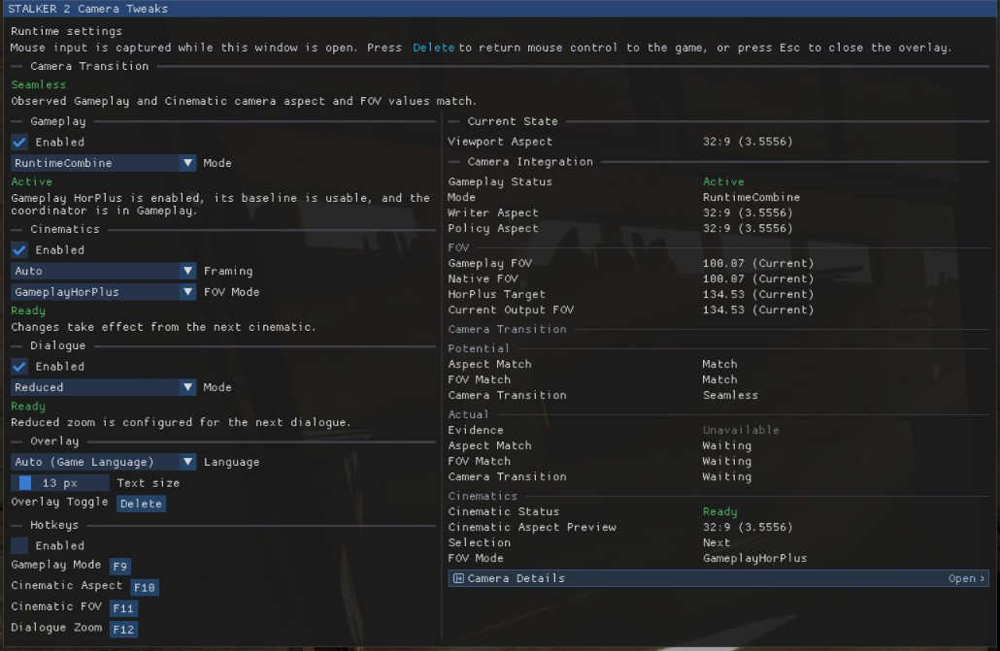
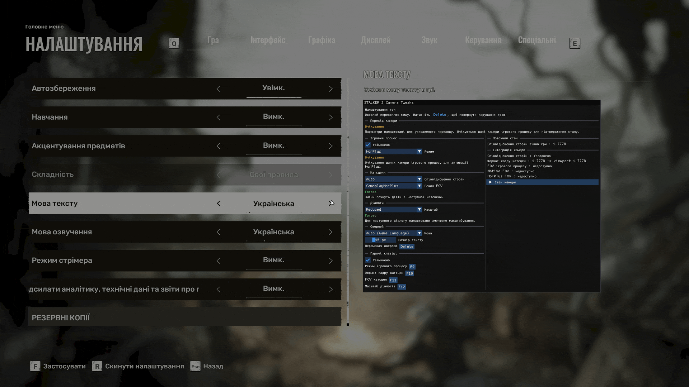

# STALKER 2 Camera Tweaks and Ultrawide for UE 5.5.4

This repository contains `STALKER2CameraTweaks.asi`, a unified camera/FOV and ultrawide mod for **S.T.A.L.K.E.R. 2: Heart of Chornobyl**. Downloads and installation instructions are available on [Nexus Mods](https://www.nexusmods.com/stalker2heartofchornobyl/mods/2416).

Camera Tweaks are not limited to ultrawide: camera/FOV options and custom cinematic framing are also available on a standard 16:9 display.

The mod is especially useful if you play with a Gameplay FOV other than the game's default 90°. Gameplay supports arbitrary valid aspect ratios, including unusual formats such as 3:1 or 48:9. The 16:9, 21:9 and 32:9 choices are cinematic framing presets—not a limit on gameplay aspect ratios.

## Features

- **Independent modules.** Gameplay, Cinematics, Dialogue and Overlay each have their own enable/disable setting. Turning one off does not disable the others. Camera modules still coordinate camera ownership during transitions when enabled.
- Uses the Gameplay FOV selected in the game's own settings as its baseline—no separate mod FOV value needs to be configured. Aspect-aware correction follows it during gameplay; by default, cinematics also use that value as their baseline while preserving authored FOV changes.
- `Gameplay.Mode` selects `HorPlus`, native `AspectRecalculation`, or `RuntimeCombine` (`RuntimeCombine` is the recommended default). `HorPlus` applies the existing Hor+ policy to the native Gameplay writer aspect. `RuntimeCombine` instead synchronizes a mismatched Gameplay camera aspect to the validated current viewport aspect, confirms the read-back, and only then applies Hor+; if synchronization cannot be confirmed, it fails closed without applying Hor+ in the unconfirmed domain. RuntimeCombine accepts arbitrary valid aspect ratios.
- Supports cinematic aspect policies `Auto`, `16:9`, `21:9` and `32:9`, independently of the display aspect. Set `Cinematics.Enabled=false` to leave cinematic camera output native.
- `Cinematics.FovMode` selects `GameplayHorPlus`, which uses the game-selected FOV as its cinematic baseline, or `NativeHorPlus`, which applies Hor+ to the game's authored cinematic FOV independently of Gameplay FOV.
- Offers three FOV-aware Dialogue zoom modes: `Adaptive`, `Reduced` and `Disabled`. Set `Dialogue.Enabled=false` to leave dialogue camera output entirely to the game; the game's default dialogue zoom targets 70° FOV.
- Includes an in-game overlay for settings, runtime status, hotkeys and a read-only Camera State view in a separate, independently scrollable panel. The Overlay has its own click-through display window; the game window retains host input and discovery responsibilities.
- The Overlay waits for a suitable game window before initializing its presenter; on some launches it may become available after the game has progressed through startup.
- Ships 18 embedded overlay languages with locale-specific font profiles; `Auto (Game Language)` follows the game's interface language.
- Uses the configured Overlay Toggle (`Delete` by default); `Esc` dismisses the open overlay. Optional mode hotkeys are disabled by default.
- `[Overlay] Enabled=false` disables the Overlay subsystem after a game restart without disabling Gameplay, Cinematics or Dialogue correction.
- The standard ASI includes supported passive runtime diagnostics. Set `[Diagnostics] Enabled=true` and restart the game to enable bounded diagnostic observations and logs; when disabled, diagnostic-only work is skipped. No separate diagnostic ASI is needed for these diagnostics.
- Creates and documents `STALKER2CameraTweaks.ini` automatically; overlay settings are saved there as well.
- Keeps the configuration and diagnostic logs local beside the ASI; no network service is needed for normal use.
- Resolves gameplay and cinematic hooks through guarded signatures and fails safely when validation is ambiguous or unsuccessful.

## In-game settings overlay

The overlay brings the mod's settings and runtime status into the game. It includes localized selector help and examples, semantic readiness messages, hotkey rebinding and the read-only Camera State view. Open **Camera Details** to show the independently scrollable third panel; close it to return to the compact two-column layout.

**Overlay overview:** the main runtime settings are shown alongside Camera Integration and Camera State information.

<p align="center"></p>

**Selector documentation:** the HorPlus help and examples show how the game-selected Gameplay FOV adapts to different aspect ratios.

<p align="center"></p>

**Camera State:** read-only runtime camera values include contextual help explaining their meaning and current availability.

<p align="center"></p>

**Localization:** the overlay can switch between its embedded language catalogs in-game.

<p align="center"></p>

## Download and installation

Prebuilt releases and installation instructions are available on [Nexus Mods](https://www.nexusmods.com/stalker2heartofchornobyl/mods/2416).

For manual installation:

1. Install [Ultimate ASI Loader](https://github.com/ThirteenAG/Ultimate-ASI-Loader) as `dsound.dll` in `Stalker2\\Binaries\\Win64`.
2. Remove previous `STALKER2UltrawideFix.asi`, `STALKER2GameplayAspectFix.asi` and their old INI/log files. Do not load old and new ASIs together.
3. Copy `STALKER2CameraTweaks.asi` to `Stalker2\Binaries\Win64`. The mod creates `STALKER2CameraTweaks.ini` beside the ASI on first launch; existing settings are migrated where recognized.
4. Start the game normally.

The plugin creates `STALKER2CameraTweaks.log` beside the game executable. The startup log includes SHA-256 values for the loaded mod and game executable, which helps verify support reports.

## Configuration

Configure the mod in-game through the overlay. Press `Delete` by default to open or close it; `Esc` dismisses the open overlay. Changes are saved to the user-owned `STALKER2CameraTweaks.ini`. The INI is generated at runtime and is not part of the release archive or Vortex copy instructions. Known older layouts are rebuilt while compatible settings are retained; structurally unreadable files are backed up before recovery.

The default configuration is:

```ini
[Gameplay]
Enabled=true
Mode=RuntimeCombine

[Cinematics]
Enabled=true
Mode=Auto
FovMode=GameplayHorPlus

[Dialogue]
Enabled=true
Mode=Adaptive

[Diagnostics]
Enabled=false

[Overlay]
Enabled=true
Language=Auto
ToggleKey=VK_2E
FontSize=13

[Hotkeys]
Enabled=false
GameplayCycle=F9
CinematicCycle=F10
CinematicFovCycle=F11
DialogueCycle=F12
```

The generated INI documents each setting's available values and examples. You can edit it manually while the game is closed; restart the game after manual changes. Diagnostics are startup-only and default to off.

## Screenshots

32:9 gameplay comparison, default FOV 90:

| Without Fix | Fix Enabled |
| --- | --- |
|  |  |

16:9 baseline, default FOV 90:


## Cinematic framing comparisons

The same cinematic framing policy can be selected independently of the physical display aspect ratio. These examples show `Auto` at 16:9, and forced 16:9, 21:9 and 32:9 framing on a 32:9 display, plus forced 32:9 framing on a 16:9 display.

| Configuration | Example |
| --- | --- |
| `Auto` at 2560x1440 |  |
| Forced `16:9` at 5120x1440 |  |
| Forced `21:9` at 5120x1440 |  |
| Forced `32:9` at 5120x1440 |  |
| Forced `32:9` at 2560x1440 |  |

`GameplayHorPlus` can also use the selected Gameplay FOV as the baseline for cinematics while preserving authored cinematic FOV changes. Custom cinematic framing is available even on a 16:9 display:

<p align="center"></p>

<p align="center"></p>

## Dialogue zoom comparisons

Dialogue zoom is calculated relative to the current gameplay FOV. The comparison images below show the available production policies on a `5120x1440` display.

| Configuration | Example |
| --- | --- |
| `Adaptive` compared with the game's default zoom at gameplay FOV 90 |  |
| `Reduced` at gameplay FOV 90 |  |
| `Disabled` |  |

`Adaptive` preserves the game's original optical zoom strength relative to gameplay, `Reduced` applies half of the Adaptive strength, and `Disabled` keeps the gameplay FOV during dialogue. Turning `Dialogue.Enabled` off leaves the dialogue camera to the game without applying a Dialogue correction.

## Known viewmodel limitation

The game's weapon/viewmodel FOV may remain incorrectly framed after certain cinematics, loads or gameplay-camera rebuilds. Aiming down sights or opening a menu can refresh the game's viewmodel state. This mod does not change that separate viewmodel path. [Weapon Viewmodel FOV](https://www.nexusmods.com/stalker2heartofchornobyl/mods/2422) can be used alongside this mod for a more consistent viewmodel correction and custom weapon FOV settings.

## Animated demonstrations

These recordings show additional runtime behavior of the unified ASI:

| Area | Demonstration |
| --- | --- |
| Gameplay aspect correction |  |
| Cinematic framing and FOV overview |  |
| Dialogue zoom policies |  |

## Tested scope and limitations

- In-game validation on Steam build `2.0.6` with Unreal Engine `5.5.4` covered Gameplay correction, cinematic transitions and recovery, Dialogue behavior, aspect changes, and Overlay operation with the Overlay enabled and disabled. See the [supported-build evidence matrix](docs/SUPPORTED_BUILD_MANIFEST.md) for the tested game-build boundary.
- Gameplay supports arbitrary valid aspect ratios; `16:9`, `21:9` and `32:9` are cinematic framing presets, not Gameplay limits.
- The Overlay includes 18 embedded languages. Arabic shaping, bidirectional text, RTL layout and runtime rendering of every glyph are not guaranteed.
- Older Steam builds have static resolver research but no separate runtime validation. A future game patch may require updated signatures; successful resolution does not guarantee compatibility.
- Detailed accumulated findings are summarized in [TESTING_AND_RESEARCH.md](TESTING_AND_RESEARCH.md).
- The game retains its native post-cinematic FOV recovery; this mod does not force or rewrite that native transition.
- Weapon/viewmodel FOV can remain incorrectly framed after a cinematic, load or gameplay-camera rebuild. This is a separate game-side issue and is not fixed by this mod.
- In windowed mode, a custom resolution whose aspect is not represented by a native game aspect mode may be resized by the game's native `AspectRecalculation` return to `Auto`. This does not mean arbitrary-aspect HorPlus is unsupported.
- Changing the game resolution during a session is validated for `Cinematics.Mode=Auto`; restart the game after changing the configuration file itself.

## Build requirements

- Visual Studio 2022 17.14 or newer with the Desktop development with C++ workload and the x64 MSVC tools component.
- CMake 3.31 or newer and Ninja 1.12 or newer. `build.cmd` discovers the supported Visual Studio installation and uses its bundled CMake/Ninja tools.
- The production source uses C++23-era language/library facilities. With the supported MSVC 17.14 toolset, `build.cmd` selects `/std:c++latest` because that compiler exposes the required C++23 feature set through that switch.
- `build.cmd` creates the production `STALKER2CameraTweaks.asi`, including the combined overlay, embedded catalogs/font profiles, bounded Auto language reader, and runtime-gated passive diagnostics. Its `OVERLAY_PRODUCTION` definition selects the shipped overlay integration.
- `tools/build/build-diagnostic.cmd` remains a compatibility wrapper that produces the separate `STALKER2CameraTweaksDiagnostic.asi` name. It carries the same approved passive diagnostics as the ordinary ASI; experimental/forensic tools remain separate and are not promoted by `[Diagnostics] Enabled`.
- `tools/build/build-overlay-settings.cmd` is a compatibility alias to `build.cmd`. `tools/build/build-overlay-poc.cmd` and `tools/build/build-overlay-discovery.cmd` are retired standalone research scripts, not supported ASI build profiles. The former still exercises the legacy `OVERLAY_RENDERING_POC` source gate.
- [SafetyHook](https://github.com/cursey/safetyhook), including its bundled Zydis source.
- [spdlog](https://github.com/gabime/spdlog).

Place dependencies under `external/safetyhook`, `external/spdlog`, and `external/imgui`, then run `build.cmd` from this directory. The script discovers the supported Visual Studio installation with `vswhere`; it does not depend on the author's local drive path. It also selects a UTF-8 console code page before CMake detects MSVC's localized `/showIncludes` prefix, so Ninja can track header dependencies correctly. Production compilation does not define research/test switches. Build objects, generated files and resources are isolated by profile/options under `build-artifacts/cm`; `CAMERA_TWEAKS_OBJECT_DIR`, when set, names the parent directory under which the isolated CMake tree is created. `CAMERA_TWEAKS_OUTPUT_NAME` still selects the published ASI path, and the prior output is retained if configuration, compilation or publication fails.

## Development and research tools

The following tools were used during development, reverse engineering and validation of this project:

### Production development

- Visual Studio 2022 and MSVC with C++23 support.
- C++23, Windows SDK and PowerShell build/automation scripts.
- SafetyHook for guarded native hooks.
- Zydis for instruction decoding and structural signature validation.
- spdlog for runtime diagnostics and support logs.
- Ultimate ASI Loader for loading the ASI in the game.
- Git for source, research and evidence history.

### Static and runtime research

- Ghidra for executable analysis, callgraph reconstruction and static ownership research.
- UE4SS for reflected runtime inspection, object discovery, function hooks, `.usmap` generation and bounded Lua probes.
- CUE4Parse with .NET 10 for direct UE5 IoStore/Zen package inspection, cooked Blueprint export recovery and Kismet analysis.
- A custom `CUE4ParseWVF` research dumper for the targeted `WVF` and `WVF_Actor` packages.
- Custom UE4SS Lua probes for AnimScriptInstance, WVF lifecycle and `MPC_FOV.TanFOV` causal validation.
- `repak`, `retoc` and `UAssetToolRivals` for exploratory IoStore extraction attempts.
- Oodle runtime/tooling support as part of the UE5 IoStore and asset-tool investigation.

### Evaluated but not used as the final path

- UAssetGUI was considered for traditional `.uasset/.uexp` inspection, but the direct CUE4Parse path made it unnecessary.
- FModel was considered for package discovery, but it was not used as the authoritative WVF analysis path.

The research tools and probes are kept under `research/` and are not part of the production release package. Download available releases from the Nexus Mods page linked above.

## License and credits

Original v1.0+ Project material is governed by the custom source-available
[LICENSE.md](LICENSE.md), which is not an OSI-approved open-source license.
It permits research, collaboration and development, but explicit written
permission is required before publishing modified or independently rebuilt
public binaries, repackaged or rebranded releases, public derivatives,
continuations or ports, or commercial distributions. Exact, unmodified release
mirrors are allowed only when notices are retained, Elhait and the original
Project are credited and linked, and the mirror is not presented as an official
release channel. The license also has a separate attribution requirement when
Project material materially informs a publicly released work, including through
AI-assisted research. General ideas and independently developed work are not
claimed; see the license for the complete terms.

GSC Game World has a separate permission for official S.T.A.L.K.E.R. 2
development, limited to material Elhait owns or can license; it does not grant
rights to third-party or game material. See
[GSC_DEVELOPER_PERMISSION.md](GSC_DEVELOPER_PERMISSION.md).

BigChenga has separate permanent permission to use and adapt covered Project
material in WIDEBOY Fixes and successor versions. A clearly attributed
continuation of this Project is permitted only under the specific conditions
in [BIGCHENGA_PERMISSION.md](BIGCHENGA_PERMISSION.md), including permanent
cessation/abandonment (not temporary inactivity), contact attempts if status is
unclear, and retention of the main license and third-party terms. This does
not grant access to Elhait's Nexus Mods account.

Versions released before v1.0.0 were published under the MIT License. Those historical grants remain valid and are not revoked by the v1.0+ terms.

Official release channels are this project's GitHub repository and Nexus Mods
page. A modified or independently rebuilt package is not an official release
unless published under explicit permission from Elhait.

Special thanks to Lyall and [STALKER2Tweak](https://github.com/lyall/STALKER2Tweak) for providing an early reference point and inspiration for this project. The project has since grown into its own independent implementation and feature set.

Special thanks to [BigChenga](https://www.nexusmods.com/profile/BigChenga), creator of [WIDEBOY Fixes](https://www.nexusmods.com/stalker2heartofchornobyl/mods/2337), for his original work on ultrawide support and for sharing reverse-engineering references, discoveries and ideas that helped this project along the way.

WIDEBOY Fixes was also used as a research reference for dialogue/camera FOV behavior. The dialogue implementation in this project was independently reverse engineered and runtime validated.

## Contact

For development questions, collaboration, licensing permissions or other project-related inquiries, you can contact me through the links available on my GitHub profile, including LinkedIn.

## Support development

- [Ko-fi](https://ko-fi.com/elhait)
- [Donatello](https://donatello.to/Elhait)
