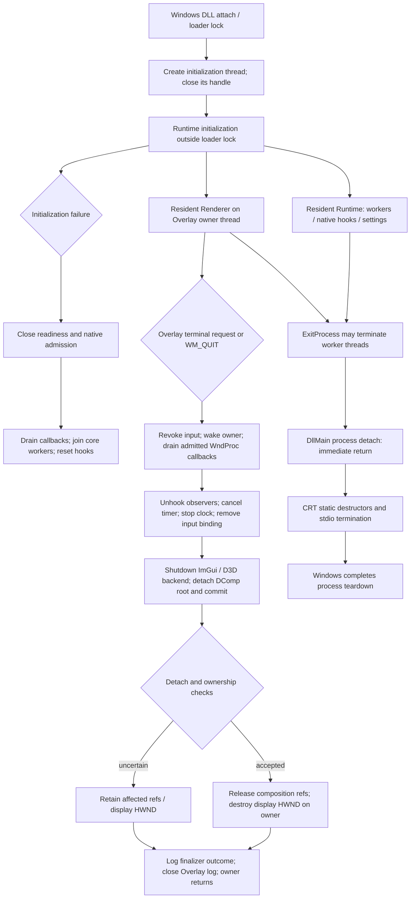

# FINAL — Native ASI Shutdown Lifecycle Audit & Closure

Date: 2026-10-17. Current hardening disposition: **FIXED for the identified
SL01/SL02 execution paths; offline qualification PASS; ordinary live exit
confirmed by the user for the candidate SHA below**. Missing final process-exit
markers remain a **DOCUMENTED LIMITATION**, not a cleanup failure.

Sections 1–9 preserve the initial, pre-hardening audit and its then-unresolved
state. Their source locations and validation status are historical. **Section
10 supersedes those dispositions** and records the current implementation,
evidence and remaining limits. This is not an unconditional Windows shutdown
safety certification.

## 1. Scope, revision and executive result

Reviewed the current working tree on HEAD
`e756442bcf9942923b4531fb513af893f6aecae7`. The tree already contains substantial
staged/unstaged G1/F2–F8 and UI work; HEAD alone does not identify its contents.
This task changed tests and lifetime documentation, not production C++.

The installed ASI, read without replacement, has SHA-256
`3C74672315624BFFDB4D7A7DE8D440035C61FB7091978C32F3C344BE967303C3`.
Its exact equivalence to the current working tree is not asserted.

Established results:

- The application's process-termination DllMain branch performs no cleanup,
  waits, graphics work, file logging or hook reset.
- The supported ASI model is resident until process termination. A production
  caller of `plugin::Shutdown()` does not exist; that helper resets camera-core
  resources and is not a combined ASI-unload API.
- Overlay terminal shutdown has a separate owner-thread finalizer, truthful
  outcome markers and intentional retention on uncertain DComp detach/commit.
- No guaranteed pre-ExitProcess handoff to either owner exists. Game-window
  destruction permits rebind rather than declaring the entire process terminal.
- Focused validation passed **11/11 contained invocations**. Actual production
  DllMain dispatch and CPU-only Renderer shutdown received additional assertions.
- An empty user DllMain does not make the whole DLL detach empty. Current /MT
  CRT/static teardown contains conditional file-lock and container-destruction
  hazards. These are evidence-backed risks; no live exit crash/deadlock has been
  reproduced or attributed to them. They prevent a blanket SAFE BY DESIGN claim.

Canonical `test.cmd`: **not run** pending clarification of the task's graphics
prohibition. Its adapter aggregate includes
`evidence-partial-imgui-cleanup`, which calls D3D11CreateDevice with software
WARP. The explicit question asks whether that existing case is permitted.
Neither a skipped canonical test nor an older PASS is presented as a new PASS.

## 2. Actual lifecycle graph

The graph has **no edge** from process-termination DllMain to controlled
Runtime reset or the Overlay owner finalizer. For the Overlay path, callback
drain occurs before the STARTED/PENDING log record. A blocked drain may produce
no STARTED record at all. Rendering/driver calls and some joins can block;
owner cleanup has no universal completion deadline.

Source anchors (repository-relative, one-based lines):

| Boundary | Source |
| --- | --- |
| Windows attach/detach dispatch | `src/plugin/dll_entry.cpp:5` |
| Resident Runtime allocation | `src/plugin/runtime.cpp:368` |
| Controlled core reset | `src/plugin/runtime.cpp:753` |
| Native admission and pass-through | `src/plugin/runtime.cpp:1442`; `src/plugin/native_callback_admission.hpp` |
| Initialization-failure cleanup | `src/plugin/runtime.cpp:6400` |
| Public core reset helper / detach notification | `src/plugin/runtime.cpp:6866`, `:6872` |
| Terminal request and durable wake | `src/overlay/composition/composition_runtime.cpp:106` |
| Game-window destruction / rebind | `src/overlay/composition/composition_runtime.cpp:858` |
| Input hook removal | `src/overlay/composition/composition_runtime.cpp:1150` |
| Owner loop and finalizer | `src/overlay/composition/composition_runtime.cpp:1315`, `:1516` |
| DComp detach and ref release | `src/overlay/presenter/renderer_runtime.cpp:1662` |
| ImGui/backend and Renderer teardown | `src/overlay/presenter/renderer_runtime.cpp:1700`, `:3004` |
| D3D backend resource release | `src/overlay/presenter/imgui_d3d11_renderer.cpp:513` |

## 3. Resource and ownership contract

| Resource | Owner and controlled release | Repetition / callbacks | Ordinary process exit |
| --- | --- | --- | --- |
| Initialization thread | DllMain closes the returned handle; worker runs independently | No retained join handle; initialization must not overlap controlled lifecycle calls | Windows terminates remaining thread; no join guarantee |
| RuntimeState, settings/config, camera/domain state and synchronization | One deliberately heap-resident Runtime owner | Not destroyed by DLL static teardown; lifecycle externally serialized | Address space reclaimed |
| Core worker threads and stop event | `WorkerLifecycle`; signal, join, close handles | Repeated empty stop succeeds; self-join retains worker instead of freeing dependencies | OS handle/thread reclamation; worker body/finally completion not promised |
| Native camera/zoom/cinematic/dialogue hooks | Runtime owns HookSet and zoom hooks | Close admission, bounded callback drain, join workers, correction gate, reset hooks; failed drain retains resources | Hook objects not explicitly destroyed; game executable memory dies with process |
| Executable trampoline/stub allocations | SafetyHook allocator; published bundles retained under existing native-continuation contract | Reset does not return executable storage that an outstanding continuation might use | Address space reclaimed; not a dynamic-unload guarantee |
| Gameplay/Cinematics/Dialogue policies and observed state | Runtime integration; reset clears applicable capability/selection flags | No new domain state owner or shutdown callback | No requirement to restore dying game objects for future gameplay |
| Renderer object, CPU notification storage and locale/font state | Heap-resident Renderer; owner releases graphics/input resources | Renderer object is not deleted by owner finalization; bounded CPU storage may remain until exit | Address space reclaimed |
| ImGui context, Win32 backend, D3D backend | Overlay owner via DetachImGui and backend Shutdown | Context/backend partial ownership released even when ready=false; no game-thread teardown | Explicit cleanup not promised |
| D3D11 buffers/states/textures/context/device references | Private backend; ClearState/Flush and COM Reset on owner | Local reference emptiness checked; Flush is not GPU/DWM completion proof | Windows/graphics stack handles process teardown asynchronously |
| DComp surface/visual/target/device | Renderer on Overlay owner | SetRoot(null), Commit, then release refs; failed detach/commit retains refs | No explicit detach/Commit guarantee |
| Overlay display HWND/class | Overlay owner; destroyed after Renderer release | Unowned HWND survives host destruction; no foreign-thread DestroyWindow | Process/thread window cleanup is OS-owned |
| Game HWND subclass, properties and binding records | Owner coordinates binding; game thread installs it | Admission closes before drain; restore only when own WndProc is topmost; foreign chain retains continuation; committed stable records not reused | No restoration guarantee needed after process death; unload remains unsupported |
| Input bridge and keyboard/rebind state | Shared CPU state; game callback revokes admission, owner finalizes input | Rejected callbacks use stable native continuation; terminal gate prevents reacquisition | Process exit ends callbacks; no retained external input hook process |
| WinEvent hooks / binding-install hook / thread timer | Overlay owner finalizer unhooks/cancels and records outcome | Independent cleanup steps attempted; failures not upgraded to Complete | OS removes process/thread-owned registrations |
| Compositor-clock worker/events | Overlay owner signals stop and joins worker before closing events | Worker only posts/coalesces wakes; never owns ImGui/D3D state | Thread/handles reclaimed; join not guaranteed |
| Terminal/drain/command wake handles and stable callbacks | Bounded process-resident Overlay infrastructure | Kept valid for late rejected/stale calls; not claimed reclaimed by graphics COMPLETE | OS closes handles |
| Main spdlog logger and registry | Resident Runtime holds logger; synchronous basic sink; explicit core Shutdown flushes | No configured async logger or periodic flusher; CRT FILE cleanup remains separate | No final application log record guaranteed; CRT may flush buffered text |
| Overlay log | Global ofstream; WriteLog serializes and flushes each record; owner closes after outcome | Frame clock joined and owner work ends before controlled close | Static/CRT destructor caveat in section 6 |
| Startup journal | Bounded static event storage + raw file HANDLE; normal Flush outside DllMain | No detach writer and no final flush call | HANDLE closed by OS; no shutdown event promised |

`OVERLAY_OWNER_FINALIZATION=COMPLETE` is scoped to that finalizer's checked
resources. It does not certify release of all process-resident records, wake
events, notification strings, Runtime resources or driver-owned work.

## 4. Scenario guarantees

| Scenario | Supported contract | Guarantees and limits |
| --- | --- | --- |
| Ordinary game exit through ExitProcess | Supported resident-until-exit model | Application DllMain returns without complex teardown. Other threads may already be terminated. OS reclaims process resources. Neither owner cleanup nor final logs are promised; CRT caveats remain. |
| Overlay terminal disable while process lives | Supported local failure/stop path | Admission revocation, owner wake, callback drain, independent cleanup steps and truthful Complete/Retained/Unverified. In-flight callback/driver stalls can prevent bounded completion. Camera core remains independent. |
| Core initialization failure / serialized reset outside loader lock | Supported controlled path | Close readiness/admission; bounded native callback drain; stop/join workers before hook reset. Self-drain/self-join retains resources. Core reset is not whole-ASI unload. |
| Explicit FreeLibrary/manual unload | **Unsupported** | Minimal notification can close native gates/signal core workers but cannot join, remove all subclass continuations or stop Overlay before code unmaps. Native callbacks can still reference module code. Do not test this as a supported production feature. |
| Crash, TerminateProcess or external forced kill | No application cleanup guarantee | DLL detach, destructors, finalizer and log flushing may all be omitted. Persistent settings can only be claimed if their earlier atomic persistence succeeded. |

Microsoft documents that ExitProcess terminates other threads before DLL
process detach and that acquiring a lock held by a terminated thread can
deadlock. TerminateProcess omits DLL notification. See
[ExitProcess](https://learn.microsoft.com/en-us/windows/win32/api/processthreadsapi/nf-processthreadsapi-exitprocess).
This is not a recommendation to replace the game's shutdown mechanism.

## 5. Why the supplied logs have no final record

The three files contain no `OVERLAY_OWNER_FINALIZATION` or
`OVERLAY_RENDERER_OWNED_REFS_RELEASED` record. The Overlay ends after ordinary
hide/geometry/activity changes. The startup journal ends at INPUT_ACTIVATED.

The source explains this without requiring a failed API or lost flush:

1. Process-termination NotifyProcessDetach returns immediately and logs nothing.
2. No production caller invokes the core Shutdown helper on game exit.
3. Game HWND destruction can trigger rediscovery, not a terminal owner request.
4. Overlay owner cleanup runs only if its terminal loop path is reached while
   that thread can still execute.
5. The startup journal intentionally has no process-detach emission/Flush.

Exact exit API, thread state and CRT progress for the supplied live run are
unknown. Main-log buffered output and file modification time do not prove
owner finalization. Absence of a record does not prove either successful or
failed cleanup. Overlay lifecycle records are flushed per record when written,
so a closed logger is not required to explain their absence.

Log identities at inspection:

| File | Bytes | SHA-256 |
| --- | ---: | --- |
| STALKER2CameraTweaks.log | 2103137 | `0D0D3F5BA89538BF414301BADE2E2B9CF63244AA6335D1EE6C972A8037AD9A0C` |
| STALKER2CameraTweaksOverlay.log | 25472 | `6577FFCC0B04167EE4BBBD18A71F0A03EC9DCA4E334BA9C49E4CB43D1258A3A3` |
| STALKER2CameraTweaksStartup.log | 1378 | `FB42DE4429E0FE25C8029D494612A93A25D46053344AF34900C65D119836DB12` |

## 6. Findings and remaining risks

### SL01 — Implicit CRT teardown can acquire locks after worker termination

**Severity:** Medium. **Classification:** evidence-backed risk, unverified in
the live game. **Disposition:** unresolved; no causal attribution to the user's
prior hangs.

Source: `CMakeLists.txt:6` selects MultiThreaded (/MT);
`src/overlay/composition/composition_runtime.cpp:60` declares a global ofstream;
WriteLog at line 263 writes/flushes it; `src/plugin/runtime.cpp:6432` creates a
basic spdlog FILE sink. The Runtime-held shared_ptr keeps the logger object
alive, but does not prevent CRT stdio termination from processing its FILE.

The installed MSVC 14.44.35207 source establishes:

- `crt/src/vcruntime/dll_dllmain.cpp`, dllmain_dispatch and
  dllmain_crt_process_detach: user DllMain is followed by CRT detach.
- `include/__msvc_filebuf.hpp:175` and `:353`: filebuf destruction closes the
  FILE; close calls fclose.
- Windows SDK 10.0.26100.0 `ucrt/stdio/fclose.cpp`, _fclose_internal: fclose
  calls _lock_file. `ucrt/stdio/_file.cpp:120` runs _flushall/_fcloseall during
  stdio termination. These paths can acquire stream/index locks.

Trigger: ExitProcess terminates an ASI thread while it owns one of those locks,
then detach/CRT attempts to acquire it. Consequence: possible exit deadlock.
The lock-taking path is confirmed; the required live interleaving has not been
reproduced. Passing direct DllMain tests cannot exercise this CRT phase.

Making only the ofstream heap-resident is **not a complete remedy**: /MT still
enumerates FILE streams. Do not make that partial change and claim closure.
The next focused proof, if needed, is an externally supervised, non-graphics
DLL exit test contrasting a released stream lock with a worker-held lock.
Any resulting repair must cover both the persistent log sinks and relevant
CRT stream ownership, then repeat that exact exit test. No custom CRT entry,
loader-lock join or DllMain flush is recommended.

### SL02 — Some mutable containers still have process-detach destructors

**Severity:** Medium. **Classification:** evidence-backed risk, not a reproduced
container-corruption defect. **Disposition:** unresolved.

Source: `src/plugin/runtime.cpp:111` global pending-notification deque;
PublishOverlayNotification/DrainOverlayNotifications mutate it under their
normal mutex. It is outside the heap-resident Runtime. Other reviewed
nontrivial teardown includes the spdlog registry and SafetyHook TrapManager
(`external/safetyhook/safetyhook.cpp:1399`, `:1489`), whose destructor removes
its VEH and destroys trap-map storage. CameraCorrectionGate also owns a
thread-local vector of deferred logging actions.

Trigger: process termination interrupts a container mutation or dependency
operation and CRT later traverses/free its storage. Process exit does not
establish that such C++ objects are consistent. No actual interrupted deque or
TrapManager corruption is demonstrated. The resident Runtime avoids this
problem for its own HookSet/mutexes; it does not cover every static object.

Minimal candidate change for the notification queue, if the interrupted-state
risk is confirmed in a focused test, is to put the queue/counter/mutex in the
existing resident Runtime with no static destruction. That would not resolve
SL01 or certify third-party teardown. Avoid blanket vendor changes without a
separate causal test. Normal notification behavior and bounded queue semantics
must remain unchanged.

### Other investigated paths

- No synchronous Renderer teardown was found in Game WndProc or DllMain.
- Native reset closes admission and retains resources on failed drain/self-join;
  published trampoline storage is not recycled under outstanding continuations.
- Terminal WndProc calls have stable predecessor records; foreign subclass
  replacement is retained rather than overwritten. This depends on ASI residency.
- Renderer releases partial backend ownership and keeps DComp references/Window
  on uncertain detach/Commit. No new double-COM-release defect was established.
- Infinite callback/clock/worker waits are outside loader lock. They are a
  completion-time limitation, not a demonstrated circular deadlock. Process
  exit does not wait for those owner functions by design.
- No async spdlog worker/flusher is configured by production initialization.
- No safe, universal game pre-exit callback exists in the current integration.
  A new graphics hook, shutdown interception or worker is not justified by
  missing log records.

## 7. Test changes and validation

Extended the existing `evidence-reset-empty` adapter scenario; scenario and
runner inventories are unchanged. It now includes the actual `dll_entry.cpp`
dispatcher and verifies:

- non-null-reserved process detach leaves runtime/admission/capabilities intact;
- null-reserved repeated notification closes native admission/gates without
  draining an already admitted callback, resetting capabilities or file logging;
- eight combinations of logical menu visible/hidden, no/partial CPU ImGui
  context and queued/no startup notification can call real Renderer::Shutdown
  twice without retained input/rebind/ImGui ownership.

These Renderer tests create no window, D3D device, DComp object or frame. Their
queued-toast branch proves teardown tolerates the queue's presence; it does not
change TTL, notification creation or presentation. It does not emulate a fully
initialized Renderer or establish a GPU-resource release result.

| Validation | Current result and limits |
| --- | --- |
| Focused build | PASS, MSVC x64 17.14.28 environment, serial build, 240 s external deadline |
| worker_lifecycle_harness | PASS; normal/partial/empty/repeated stop and worker capacity |
| input_state_harness | PASS; real hidden Win32 subclass/owner-window cases, admission and guarded one-shot finalizer; no graphics device |
| composition_presenter_state_harness | PASS; deterministic lifecycle/notification/attachment policies |
| evidence-reset-empty OFF/ON | PASS; new detach and eight CPU-only shutdown combinations |
| evidence-native-callback-reset-drain OFF/ON | PASS; real adapter close/drain/self-reset and native pass-through |
| evidence-reset-self-join OFF/ON | PASS; failed self-join retains resources, later control reset succeeds |
| evidence-reset-native-hook OFF/ON | PASS; local native patch removal/original bytes after worker join |
| Total focused invocations | **11/11 PASS**, each externally limited to 20 s with verified process-tree cleanup |
| Current registry audit | PASS: 59 targets / 62 ordered invocations / 105 adapter scenarios / 210 child processes; missing inputs=0. Inventory check only, not execution of that entire matrix. |
| Canonical test.cmd | PENDING scope clarification for its existing software WARP case; not run |
| Production Release build | Not run: production C++ was not changed by this task |
| git diff --check | PASS at inspection; unrelated existing line-ending normalization warnings are not whitespace failures |
| Live exit / CRT interrupted-lock test / full DComp finalization | Not exercised |

Raw focused results: ignored `build-artifacts/shutdown-audit/focused-build.json`,
`focused-01.json` through `focused-11.json` and `registry-audit.json`. The supervisor uses owned Job
Objects, output caps and verified descendant cleanup. No game, desktop graphics,
ETW or PresentMon session was launched. No remaining compiler, linker, Ninja or
named focused harness process was observed after the run. This does not claim
that unrelated driver/system state has been inspected or changed.

Final normal `git diff --check` returned 0. A separate diagnostic invocation
with autocrlf disabled classified existing CRLF bytes as whitespace; it was not
used to rewrite files or to override the normal repository configuration.
The installed ASI hash remained unchanged after validation.

Existing G1-D/F4 evidence was reused for design context; its previous graphics
results were not rerun or reassigned to the current installed ASI.

## 8. Shutdown logging policy

Expected **only if the Overlay owner reaches its terminal finalizer**:

- `OVERLAY_OWNER_FINALIZATION=STARTED outcome=PENDING` after callback drain;
- `OVERLAY_RENDERER_OWNED_REFS_RELEASED=0|1` after attempted cleanup;
- `OVERLAY_OWNER_FINALIZATION=COMPLETE|RETAINED|UNVERIFIED` with individual results;
- display-window/class destruction records when those steps succeed.

They already represent more precise evidence than new redundant marker names.
No `MOD_SHUTDOWN_BEGIN`, `MOD_SHUTDOWN_COMPLETE` or `HOOKS_SHUTDOWN_COMPLETE`
was added: no combined guaranteed pre-exit caller exists, core reset can retain
resources, and a DLL detach logger would introduce loader-lock work. A finalizer
COMPLETE record is not a module-wide completion record.

## 9. Closure decision

| Required claim | Disposition |
| --- | --- |
| User DllMain avoids complex loader-lock teardown | **SAFE BY DESIGN**, source + direct dispatcher tests; does not include CRT |
| Missing final records explained | **DOCUMENTED LIMITATION**, supported resident-until-exit model |
| Controlled callback/worker/input/owner order | Reviewed, focused PASS within stated limits |
| All implicit DLL teardown free of deadlock/UAF risks | **UNRESOLVED**, SL01/SL02; no live failure proven |
| Canonical current regression | Incomplete pending WARP clarification |
| Implemented production defect fix | None; no source behavior changed merely to generate logs |

The audit establishes why no final marker is guaranteed and what the actual
owners do. It does **not** certify comprehensive shutdown safety or completed
live graphics cleanup. The strongest requested closure remains open for the
explicitly bounded risks and validation above.

Platform references:

- [DllMain](https://learn.microsoft.com/en-us/windows/win32/dlls/dllmain): loader
  lock and process-termination thread constraints.
- [DLL best practices](https://learn.microsoft.com/en-us/windows/win32/dlls/dynamic-link-library-best-practices):
  keep process-termination cleanup minimal; interrupted process state may not
  support ordinary memory/resource cleanup.
- [Visual C++ DLL runtime](https://learn.microsoft.com/en-us/cpp/build/run-time-library-behavior?view=msvc-170):
  CRT startup/detach surrounds the user DllMain and executes static destructors.

## 10. Post-audit safety hardening and scoped closure

### 10.1 Exact objects and execution paths

| Object/path | Established mechanism before repair | Current disposition |
| --- | --- | --- |
| Global Overlay ofstream / filebuf | Its CRT destructor calls fclose, which takes the FILE lock; its owner can be terminated during a write | **FIXED**: resident OverlayLogState contains a NativeFile HANDLE and its mutex; no automatic T destructor is registered |
| Runtime's basic_file_sink | Even with resident logger ownership, /MT stdio termination enumerates its FILE | **FIXED**: direct, unregistered spdlog::logger with NativeLogSink; synchronous WriteFile records, no FILE or registry ownership |
| INI input and staging streams | A config save/read can be active when process exit begins; its FILE also appears in /MT global stdio state | **FIXED** for these paths: NativeFile transport, existing stream parser fed from memory; native staging flush/close before existing MoveFileEx replacement |
| ImGui automatic settings I/O | Default IniFilename permits initial FILE loading/saving even though mod windows already opt out of saved settings | **FIXED**: IniFilename=null; mod placement remains in main INI, all existing NoSavedSettings flags unchanged |
| Global pending-notification deque/counter/mutex | CRT can destroy the deque after interrupting a publisher/drainer | **FIXED**: moved into the already resident RuntimeState; same aliases, queue bound, ordering and mutex |
| SafetyHook TrapManager unique_ptr / map / VEH | Static destructor can traverse interrupted map storage and remove the VEH under loader lock | **FIXED**: singleton remains resident; normal per-operation trap add/remove still runs under its existing mutex |
| SafetyHook allocator weak_ptr state | Static weak_ptr assignment can be interrupted during hook setup; its destructor later touches ownership/control-block state | **FIXED**: one lazily constructed resident holder, retaining the same mutex and weak-reference semantics |
| Retained VEH during other DLL detach | Keeping a VEH alive must not make it lock/inspect a map owned by a killed installation thread | **FIXED** for this handler: cached RtlDllShutdownInProgress check returns CONTINUE_SEARCH before locking or map access |
| Thread-local deferred logging vector | Other threads' TLS destructors are not run after ExitProcess kills them; no cross-thread destructor path was established | **Unchanged**; no speculative lifetime rewrite |
| Scalar atomics, POD publication records and existing MSVC mutex storage | No blocking/resource-owning destructor path was established for these objects | **Unchanged** |
| Standalone language-state research watcher | Not in the ordinary ASI source registry | Outside this bounded production repair |

The old live hang is not attributed to any of these paths. The fixes remove
identified destructor/stdio ownership mechanisms irrespective of whether the
original user session exercised them.

### 10.2 Ownership, initialization and explicit unload

`src/platform/process_lifetime.hpp` provides in-place storage with a trivial
wrapper destructor. The contained owner is constructed normally and is not
registered for CRT destruction. Global Overlay storage has one initialization
in its own translation unit; its file operations remain serialized. The owner
can explicitly CloseLog while alive, including repeated/partial paths. Windows
reclaims an open handle on process death. There is no new shutdown manager,
worker or periodic activity.

Runtime already had process-lifetime ownership, so its notification fields need
no new allocator or synchronization scheme. The queue remains capped at eight
entries and IDs advance under its original mutex. SafetyHook singleton creation
continues under its existing lock; the allocator holder uses normal C++ guarded
one-time initialization and keeps stable addresses thereafter.

The initialization worker calls PinModuleForProcessLifetime before installing
hooks or starting Overlay, and aborts initialization if pinning fails. This is
outside DllMain. After that point, a later FreeLibrary cannot unmap callbacks,
VEH or resident owners. Repeated pin calls and an actual exported DLL call after
FreeLibrary are exercised in the process-isolated test. Racing unload against
the original asynchronous attach-to-initializer handoff is still unsupported;
there is no promise to repair a loader that unmaps executing initialization code.

The retained VEH uses a lock-free atomic function pointer. GetModuleHandle and
GetProcAddress run before acquiring the trap mutex, never from the handler.
If the Windows 10+ shutdown probe export is unavailable, hook patch installation
fails before writing rather than installing an unguarded trap. No new VEH or
process-exit interception is added. Existing DllMain and worker lifecycle code
were not modified. No COM/D3D release, joins, file flush or new thread was added
to DLL_PROCESS_DETACH.

Microsoft specifies the pin's residency guarantee in
[GetModuleHandleExW](https://learn.microsoft.com/en-us/windows/win32/api/libloaderapi/nf-libloaderapi-getmodulehandleexw)
and the termination-state query in
[RtlDllShutdownInProgress](https://learn.microsoft.com/en-us/windows/win32/devnotes/rtldllshutdowninprogress).

### 10.3 Normal-operation behavior and transport limits

NativeFile wraps CreateFile/ReadFile/WriteFile/CloseHandle without a CRT FILE.
Its ordinary scoped destructor is appropriate for non-global INI operations;
resident log owners do not invoke it through CRT at process exit. File handles
are never shared without the caller's mutex, and they are not publicly exposed.

The main logger remains synchronous and keeps its pattern and configured error
handler. Each record reaches Windows through WriteFile immediately; flush has
no remaining user-space buffer to drain. It does not claim power-loss durability.
The Overlay log retains its CRLF line format and explicit owner-side close.
INI staging additionally calls FlushFileBuffers, checks close and uses the same
atomic replacement path. This can wait for storage during an ordinary save;
it is not invoked from loader-lock shutdown. No performance improvement is
claimed for the changed file transport.

Config parsing, compatible settings migration, documentation, malformed-file
backup, no-op identity and multi-value atomic update rules are unchanged. The
config suite passed their existing regression assertions. All mod windows
already used NoSavedSettings, so disabling ImGui's separate default disk file
does not replace the main INI or change the custom layout/position contract.

### 10.4 Current validation and discriminating controls

| Check | Current evidence |
| --- | --- |
| Focused lifecycle/config build and execution | **12/12 PASS**; external 420 s build deadline, 20 s per execution, cleanup verified |
| Native logging | Two initialization rounds with the same unregistered logger name; four writers x 128 records each round; every ID seen once, no interleaving/corruption, CRLF and UTF-8 preserved, Unicode path readable while logger remains open |
| File failure/repetition | Closed-handle write refusal, missing-file read preserves output, native byte roundtrip, flush and repeated close |
| Resident storage | Compile-time trivial wrapper destruction plus actual destructor-counter check; no T destruction on wrapper scope exit |
| Real DLL lifecycle | LoadLibrary, repeated pin, FreeLibrary, then actual exported call; worker holds owner mutex while child calls ExitProcess; resident variant exits with expected code 7, preserves only before_exit, and leaves no child process |
| Negative automatic-owner control | Actual DLL static destructor emitted DESTRUCTOR_BEGIN but not DESTRUCTOR_RAN, process exited 7; this is observed incomplete teardown, **not** an observed timeout/deadlock |
| Negative old-ofstream control | Worker holds the real MSVC filebuf/FILE lock; CRT destructor emitted CRT_DESTRUCTOR_BEGIN but not CRT_DESTRUCTOR_END, process exited 7; likewise no hang is claimed |
| VEH shutdown guard | Existing native lifetime-fault scenario calls the actual trap handler while holding its mutex, with a shutdown probe result; handler returns CONTINUE_SEARCH without trying to lock/read the map; Diagnostics OFF/ON |
| Resident notification queue | Actual production publication/drain with four publishers and 512 IDs; monotonic, nonduplicated delivery, bounded eviction semantics retained, final queue empty; OFF/ON |
| Detach/drain/partial/repeated paths | Existing actual DllMain, CPU-only Renderer, callback drain, self-join and native-hook reset checks PASS |
| Canonical safe portion | `test.cmd -NonGraphics` **PASS**: 59 targets, all 62 ordered runner invocations, **208 adapter children**, four Zoom scenarios; the single WARP scenario (two modes) explicitly omitted |
| Production Release | **PASS**, ordinary production profile with startup journal and standard INI-controlled Diagnostics |
| Production/test isolation | The production SafetyHook compile command contains no SAFETYHOOK_TEST definition; the separate adapter dependency command intentionally does. The new DLL probe is only a dependency of the worker harness. |
| git diff --check | PASS under normal repository configuration |
| Installation/config preservation | Installed ASI and INI SHA-256 unchanged |
| Game / WARP / desktop graphics / captures | Not launched |

The negative controls make the evidence distinction concrete: a completed
process with exit code 7 does not by itself establish that its destructors
completed. Current Windows can cut termination work short rather than leave a
long-running process. No internal OS mechanism or earlier game failure is
claimed from these controls alone. A first launcher argument-construction error
was discarded; only the corrected two-argument control runs and their trace
files support the table above.

The canonical safe run covers the final production source. The subsequent
test-only change added entry/exit witnesses to the negative-control DLL; that
DLL was rebuilt and the focused lifecycle/config checks rerun. It did not alter
production or require repeating the entire matrix. The full graphics-inclusive
canonical suite remains **not run**, not relabeled as PASS.

Durable result copies are in
`research/evidence/native-runtime/shutdown-hardening-2026-10-17/`;
working outputs are in ignored `build-artifacts/shutdown-audit/`. The controls
and all build/test descendants were supervised by owned Job Objects. No game
or unrelated process was terminated as cleanup, and no TerminateThread call
was introduced or used by this repair.

### 10.5 Release candidate

Path: `build-artifacts/shutdown-hardening/STALKER2CameraTweaks.asi`.

- Size: **3,568,128 bytes**.
- SHA-256: `97696DBA3C40067F4F89D8C8F62D2D93C5AD2A97707860492E723A4E2016F5D4`.
- Installed rollback/current ASI remained
  `3C74672315624BFFDB4D7A7DE8D440035C61FB7091978C32F3C344BE967303C3`.
- User INI remained
  `11C1E8CACFAD54137EDC649EED8BA4220933F69560DB6D4C4538B6DF01B41BD9`.
- Candidate was not installed. No release ZIP/INI packaging was changed.

### 10.6 Final guarantees and remaining qualification

**SL01: FIXED for the identified production log/config/automatic-ImGui FILE
paths. SL02: FIXED for the identified notification, allocator-reference and
TrapManager static destruction paths.** Runtime camera formulas, native
signature/patch algorithms, Overlay drawing/layout, readiness and TTL behavior
were not changed by this hardening.

This does not certify arbitrary third-party destructors, CRT internals, a
damaged process, unsupported manual mapping/unload, crash recovery or graphics
driver completion. A process-lifetime allocation is intentional bounded
retention, not a claim of explicit COM/driver release. Unused generic vendor
file APIs remain compiled but no additional production execution path to them
was established. Thread-local storage was not rewritten speculatively.

The existing Overlay finalizer markers remain truthful when that owner runs.
Normal process exit still need not emit MOD_SHUTDOWN_COMPLETE. No artificial
cleanup or logging was added to manufacture that record.

**Live exit qualification: PASS for the observed ordinary-exit scenario.** The
user confirmed the candidate was tested in a normal game session and exited
through the ordinary game path. The three logs were inspected: initialization
and Overlay open/close transitions were present, with no logged error or
exception; the game process was no longer present afterward. The logs do not
prove every thread/driver teardown detail, and the absence of a finalizer
marker remains expected under process termination. No Gameplay/Cinematics/
Dialogue replay was performed or required for this shutdown-only change.
